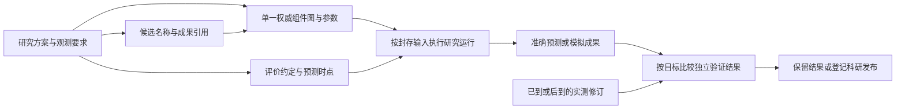

# 农业数学建模设计器架构评估

2026-11-11 · 以 JMP Pro 为建模交互参考，结合现有代码、249 公开入口和两份温室番茄研究原件。本文记录评估和实施建议，已按工程规范复审。详细触发场景、源码依据和验收见 [方案复审记录](model-designer-architecture-review.md)。

## 对话中你明确提出或认可的方向

1. **组件规范是底层基础。** 组件要有统一开发模板、清晰结构、可独立复跑的验收。后续普通授权用户可以上传并使用自己的组件。工程按逻辑、结构、用法组织，模块职责单一，共用规则和方法集中维护。
2. **设计器要能从空白建立和编辑研究。** 普通用户能找到入口、理解变量和组件连接、修改方案。保存后还应能启动研究并看到实际计算结果。用至少一个模型的运行结果验收交付。
3. **研究可以选择任意数量的因子和多个目标。** 因子的数量由研究设计及所选方法的能力决定，界面支持持续添加。株高可以和 NDVI、土壤水分、气温一起研究，也可以在同一份方案里预测株高和叶面积。日期和跨多天采样要进入模型和验证设计。
4. **拟合和成果随方法变化。** 逻辑斯蒂可以有生长曲线和参数。线性回归、机器学习和其他模型按各自的计算方式配置，产出预测表、训练模型、评价报告或相应成果。
5. **组件结果可以串联。** 用户能看见和编辑连接，上游实际产生的结果可以作为下游输入。一个逻辑斯蒂株高预测可用作下游回归的候选因子，同一行还要绑定独立实测株高供训练或评价。
6. **产品围绕数学建模和农业研究组织。** 以研究对象、问题、变量、候选关系和验证为主线。采用 JMP Pro 作为本轮主要对照。项目在 249 独立运行，使用新项目的独立研究库。

## 现有架构与 JMP Pro 对照

JMP Pro 的 Fit Model 先给数据列分配角色，再定义模型项和拟合方法。它允许选择一个或多个响应列，提供交互、嵌套等模型项，部分方法可指定验证列。Model Comparison 按响应列组织候选、指标和诊断图，并提示缺失值会影响对比的分数。广义回归官方示例把多个估计方法放在同一验证列下比较。下表的农业数据约束、制品管理和运行调度是本项目自己的设计职责。 [Fit Model 字段和模型项](https://www.jmp.com/support/help/en/19.2/jmp/elements-in-the-fit-model-launch-window.shtml) · [比较报告](https://www.jmp.com/support/help/en/19.2/jmp/the-model-comparison-report.shtml) · [同一验证列的对比示例](https://www.jmp.com/support/help/en/19.2/jmp/example-of-the-model-comparison-table-in-generalized-regression.shtml)

| 评估项 | 已核实的现状 | 下一步和验收 |
| --- | --- | --- |
| 研究入口与用户操作 | 公开页面支持从空白配置、导入导出、串联样例和浏览器草稿。私有草稿和发布有独立受权 API。页面的主要工作区仍是组件图，浏览器保存使用本地存储。 | 首屏让用户明确研究目标、对象、输入与数据就绪情况。按「研究与数据 → 候选模型 → 结果与验证」组织。连接作为候选模型内可发现、可编辑的「数据流」。用普通账号从空白保存，换浏览器可重开云端草稿并启动。 [页面入口](../modarchitect/web/designer/index.html) · [保存逻辑](../modarchitect/web/designer/studio.js) · [私有接口](../modarchitect/routes.py) |
| 研究问题与模型定义 | `ResearchPlan` 已有四种研究目的、变量、采集要求、单个组件图、输入配方及评价策略。图已能承载多个分支，尚缺可命名、复制和同台评价的候选定义。 | 一份权威图保存结构和参数，候选引用其预测或模型输出端口，实际运行清单再关联成果摘要。模型表单定向编辑图节点配置，数据流展示同一份定义。复制回归候选后只改变 NDVI 使用，导出、发布和重开均能核对差异。 [方案合同](../modarchitect/contracts/research/plans.py) · [JMP 支持的模型类型](https://www.jmp.com/support/help/en/19.2/jmp/model-specification.shtml) |
| 多因子、多目标和时间 | 方案与回归能接收列表。回归 V1 在共同完整样本上对多个目标计算各自的线性系数，输出模型与预测表。现有表单依赖组件请求 Schema。 | 保留任意数量的输入列和目标列。每个目标有自己的测量单位、可用标签、误差和样本数。需要时允许按目标指定不同候选方法或采用联合模型。用 4 个以上因子、两个单位不同的目标验证配置、执行及评价。 [回归计算](../components/multivariate_regression/component.py) · [多变量测试](../tests/test_designer_demo.py) |
| 农业观测与样本配对 | 领域合同能描述地块、点位、样株、处理或分组。当前可执行观测构表只接收 `field_season` 级数值，方案编译拒绝目录来源绑定及部分报告配置。日期相同也无法自动证明影像像元与人工取样覆盖相同。 | 优先接通一个真实地块日观测来源。随后按实际用例接通样株、样方或温室小时数据。配对明确对象、空间支持、日期或时刻、容差、汇总方法、缺配原因。用同日不同地块拒绝、样株误配拒绝和明确的汇总结果验证。 [对象和变量](../modarchitect/contracts/research/variables.py) · [适配限制](../modarchitect/validation.py) |
| 组件连接与数据语义 | 已按端口版本、形态及合同编译，跟踪已知表列、实测性质及基线截点。串联样例按对象和日期对齐。若新增约束继续分散在组件代码名的条件分支里，每增加方法都可能改通用校验器。 | 把模型需要的列、支持的角色和粒度、输出的值性质、时间截点及适用范围写入版本化声明。通用规则统一判断，算法特有规则由组件校验。验收增加一个采用既有端口合同的用户组件，能生成配置并正确接线。 [输入绑定](../modarchitect/contracts/research/input_bindings.py) · [表列来源传播](../modarchitect/contracts/research/table_lineage.py) · [串联记录](model-composition.md) |
| 独立评价和结果比较 | 评价策略可以表达多目标和按时间或对象划分，数值门槛目前只有一个可选目标，适用于时间切分。已核对的串联样例返回模型和预测表，当前缺统一的多候选对照。 | 独立保存每个候选的切分、配对覆盖、验证预测、误差和诊断。选择模型使用验证集，对外宣称精度时使用未参与选择的独立测试。不同目标分别评价，相同目标和同一评价样本上的模型才直接对比。 [评价策略与规则](../modarchitect/contracts/research/plans.py) · [门槛合同](../modarchitect/contracts/research/evaluation.py) |
| 实际运行、复现和采用 | 方案发布可冻结组件版本及合同。249 已有三组件隔离串联的工程验收。公开入口与 OpenAPI 当前提供设计校验与草稿发布，运行接口仍缺。组件包有清单预检，正式用户上传、隔离执行和采用闭环待验收。 | 先跑通独立库内一次正式研究运行，记录封存输入、候选定义、组件制品、数据划分及成果摘要，贯通 DolphinScheduler 实例和 Worker 结果。然后验收用户制品上传、复跑、获准采用、权限范围内执行和旧版复现。 249 记录 · [清单预检](../modarchitect/package_preflight.py) · [运行验收规划](model-designer-dolphin-acceptance.md) |

优先级最高的缺口是，用户目前能组成计算，却无法在同一研究里完成「比较候选、查看独立证据、启动正式运行」。现有端口、合成串联和版本冻结为这个闭环提供了基础。

## 两份知识资料对通用建模的要求

核对了卢沐鑫的学位论文《融合日光温室番茄表型自动监测的智能灌溉方法研究》，以及中文稿《基于 RGB、多光谱及热红外多源数据的温室番茄生长无损监测与建模研究》。两份材料在北京大兴试验、三个品种、581 个样本和 7∶3 划分等细节上相近，定植日期记载有差异。鲜重研究暂按可能重叠的一组证据处理。以下将论文结果用于提出研究与验收方向，实际精度以本项目数据检验。 [学位论文原件](<E:/CodexData/home/worktrees/enterprise-model-services/mlgrowth/docs/knowledge-base/sources/卢沐鑫-融合日光温室番茄表型自动监测的智.pdf>) · [中文稿原件](<E:/CodexData/home/worktrees/enterprise-model-services/mlgrowth/docs/knowledge-base/sources/三合一论文-2026-1-28-中文版-Ma.docx>)

| 论文研究方向 | 给设计器的直接要求 |
| --- | --- |
| 中文稿 §2–3、表 S3 的多源表型和单株茎叶鲜重估测。研究比较了 RGB、多光谱、热红外及多种回归方法，连续鲜重标签含异速方程推导。 | 允许同一算法逐项增加数据来源，查看配对误差与覆盖率。区分人工量测、直接称重、公式推导、影像估测和模型预测。评价实测鲜重需要留出直接称重的样株。用样株标识和影像配准结果追溯来源。 |
| 学位论文第 3 章的连续表型监测。人工株高、影像株高、生长趋势分别存在。覆盖度和叶面积的关系在高覆盖区趋缓。 | 让用户在同一对象与日期上叠加实测、估测及曲线，按生育阶段查看残差。单株叶面积、叶面积指数 LAI、冠层覆盖度保留各自单位和空间分母。高覆盖分层边界由试验设定。 |
| 学位论文第 4 章的小气候预报和蒸腾。表 4-2 按 24、48、72 小时给出误差。式 4-5 将机理基准差异作为损失项，表 4-3 对照纯数据、迁移、机理约束与融合候选。 | 区分数据可用时间、预测发出时间、目标时刻和提前量。支持以持久性、机理和数据模型并列作基线。记录软损失和运行时物理边界的不同证据。小时称重参照与日蒸散要显式记录时间步长和面积转换。 |
| 学位论文第 5 章的灌溉策略。表 5-8 同时记录用水、产量和灌溉水生产率。策略比较依赖对照组和试验条件。 | 预留处理组、独立试验单元、实测流量和多个评价指标。将情景模拟、建议、实际操作和结果分别记录。要回答策略效果，需另有可核查的对照和重复设计。 |

农业共用字段从作物、品种、地块或温室、种植季、观测单位和日期出发。定植后天数、积温或生育阶段可作为分析时间轴，原始采样时间同时保留。变量采用「性状或环境量、测量方法、单位」描述，另记录来源及空间覆盖。MIAPPE 提供农业表型元数据参考，APSIM 提供土壤、气象、管理情景和实测对照参考。冬小麦无人机田间试验也说明跨生育阶段应重新核对可用特征与模型表现。 [MIAPPE](https://www.miappe.org/overview/) · [APSIM 农事情景](https://docs.apsim.info/docs/user-tutorials/module4/modulefourtutorial) · [APSIM 预测与实测配对](https://docs.apsim.info/tutorial/PredictedObserved) · [冬小麦田间研究](https://link.springer.com/article/10.1007/s41064-022-00229-5)

## 通用模型设计的职责划分

- **研究方案描述要验证的问题。** 沿用现有目标、采集规则和版本。增加可复用的验证约定，明确要预测的对象和时点、可用因子、对照基线、评估样本、指标以及通过条件。探索关系、估测或预测、处理效应、机理模拟各有适用的证据和界面。处理效应显示分组、对照和试验重复，机理模拟显示初始状态、驱动、参数、步长和情景。
- **候选模型声明可比较的输出。** 在同一份研究图中引用预测、模型等输出端口，实际成果在执行后登记。因子和方法参数由相关节点提供，界面直接编辑该权威配置。变量保留科学定义，在各节点绑定其目标或因子用途，研究层保留处理和分组设计。线性回归选择主项，组件支持时开放变换和交互。生长模型展示函数、参数、拟合或求值方式、初值及收敛情况。树模型展示训练配置、特征和预测结果。自定义公式采用受支持的结构化运算。 [JMP 非线性模型](https://www.jmp.com/support/help/en/19.2/jmp/nonlinear-regression.shtml) · [JMP 曲线公式和适用条件](https://www.jmp.com/support/help/en/19.2/jmp/statistical-details-for-fit-curve-models.shtml)
- **观测构表和配对负责农业数据口径。** 统一校验来源和修订、观察单元与试验单元、空间覆盖、有效时间及可用时间。清洗、配对和汇总的规则及异常可回查。上游估测可作为特征，其来源性质继续传到下游。超出模型声明的范围时明确提示外推。
- **组件合同描述可组合能力。** 在现有清单、端口和请求 Schema 上复用版本规则，补齐声明式变量角色、输入列及派生输出约束。以真实的第二种方法和不同粒度观测验证扩展点，再抽取重复逻辑。模板、预检、正反例、制品摘要和隔离执行继续共用。 [现有组件模板与串联入口](../components/README.md)
- **研究运行与评价保留可复跑证据。** 研究运行引用方案版本、候选集合、来源、评价约定和组件制品，回测时封存已存在的标签及切分。每次组件调用关联切分、节点、执行尝试和输入摘要。服务端统一检查授权和科学约束，Worker 验证封存输入并计算，DolphinScheduler 调度。首次沿用一次调度启动 Worker 执行封存图。独立分支可保留成功结果，失败依赖及无有效评价清楚展示。旧方案通过兼容视图显示为单候选，读取保留原载荷和准确摘要。 [已有迁移约定](model-designer-migration.md)

训练成果另有独立推理入口。模型制品冻结特征顺序、目标、单位、预处理状态及执行版本，次日预测绑定准确模型和当时可用因子。每次训练或参数更新形成新的准确成果，历史评价仍指向原成果。成果的跨研究引用核对访问权和适用范围。

草稿容许未完成编辑，首期发布冻结整份完整有效图。运行从准确方案版本选择候选，由编译器提取对应输出端口的上游依赖并封存执行图，记录其来源及编译器版本。

预测任务明确起报时刻、目标时刻和提前量，样本绑定起报时已知因子与目标时刻的实测。评价快照封存实际样本、观测修订、切分和覆盖，预处理及各层拟合受同一切分约束。滚动预报的新结果合同保留同一目标日的多次起报。多目标分别拟合时各自保留样本与评价，联合方法声明共同样本要求。资源配置同时覆盖单调用与整项研究预算，支持范围和采用资格由版本化合同准确表达。

在线预测先封存已有特征、模型及任务，成功出预测后可等待实测评价。后到或修订的实测通过新的评价快照或独立评价运行引用原预测摘要，原预测输入与成果的封存身份可持续追溯。

## 第一条真实研究与交付次序

**先验收同一地块或温室、同一种植季内，利用截至预测日已获得的数据预测后续实测株高。** 目标是株高（cm），预测提前量由采样频率决定。先跑株高，再加实测叶面积验证多目标。若只有同期可配对影像，先明确运行的是当天株高估测，并建立独立的提前预测方案。株高便于重复人工测量，能直接验证日期关系、基线、串联和独立误差，具体可用程度由实测决定。

「NDVI 与株高随日期的关系」可以先用探索任务查看两条观测序列和按日期配对后的关系图，再复制方案进入预测任务。日期在第一步用于对齐观测，也可派生为定植后天数供生长模型使用。进入预测后，再明确以哪天为预测起点、要预测哪天、因子在哪天可获得。首次候选采用如下结构。

| 候选 | 研究作用 |
| --- | --- |
| A · 最近一次实测基线 | 用起报前最近一次合格株高估计目标时刻株高。数据足够且适用时另加逻辑斯蒂时间基线。 |
| B · 生长时间、起报时可用的土壤水分和气温进入直接回归 | 先检验直接模型。训练样本按任务绑定因子时点和未来实测株高。 |
| C · 复制 B，只增加 NDVI | 在相同训练行、评价行和时间条件下量化 NDVI 的增量贡献。另列实际运行时各模型可产生结果的覆盖率，显式展示因缺少合格影像而无法预测的日期。 |

逻辑斯蒂预测进入下游回归继续作为独立的组合验收和后续候选。它使用明确的上游训练期及下游训练样本，并对整链评价。各直接回归候选可以独立运行和比较。

先锁定预测任务、来源与比较样本。后续日期留出用于同季外推，整地块或整棚、整种植季留出用于验证迁移性。重复观测按独立单元分组。回测每个时点时，所有特征和上游预测只能使用当时已可得的数据，特征选择、校准和标准化在训练范围内拟合。当前串联按先后截点演示；扩展为滚动预测时，每个下游训练样本的上游预测也要由它之前的数据产生，或按匹配部署场景的折外方式生成。先看配对覆盖、样本和独立对象数，再按目标与提前量展示 MAE、RMSE、偏差和残差，必要时按生育阶段或品种分层。 [结构化数据交叉验证研究](https://doi.org/10.1111/ecog.02881) · [串联训练的折外预测原则](https://scikit-learn.org/stable/modules/generated/sklearn.ensemble.StackingRegressor.html)

| 优先级 | 工作及放行条件 |
| --- | --- |
| P0a · 跑通单候选真实研究 | 普通授权用户从空白定义目标、保存并重开，在已确认的隔离环境启动一个候选。真实来源和 DolphinScheduler、Worker 贯通，报告能追查实测与成果。检查输入冻结、重复启动和晚回传。缺数据或授权时保留明确原因，候选与评价身份在此阶段确定。 |
| P0b · 同方案候选比较 | 用一份权威图定义 A、B、C，模型表单与数据流编辑同源。任务时间、训练行和评价行一致，显示各候选误差、覆盖和失败原因。 |
| P1 · 串联、推理与用户接入 | 依次验收上游成果供下游、准确训练模型跨次推理、株高与叶面积分目标缺测。随后用普通授权用户走完独立组件上传、隔离验收、获准采用、加入方案及执行。合同与采用引用在前期设计中确定，检查升级、撤销和资源终止。 |
| P2 · 扩展到不同农业研究 | 以多源鲜重估测检验样株粒度及标签来源，以温室小时蒸腾检验提前量、时间步长和机理输入，以灌溉研究检验独立处理组与多指标效果评价。每项等相应业务数据和科学参照就绪后按独立证据验收。 |

## 本次验证范围

- 本机执行 `./.venv/Scripts/python.exe -m pytest -q -rs`，9 项通过，3 项因未配置专用 PostgreSQL 测试库而跳过。此前串联批次记录了带隔离 PostgreSQL 的 12 项通过。 [串联复跑记录](model-composition.md#复跑记录)
- 249 健康检查正常，公开串联样例返回 200。将样例提交 `/designer/validate` 返回 `valid=true`，编译顺序为 `baseline → merge → regression`。访客访问私有草稿返回 401，OpenAPI 未列出研究运行或启动路由。历史容器复跑得到合成株高预测 91.48452580 cm。正式业务身份、实测数据配对及从页面启动到调度结果回传仍待闭环验收。 [公开样例](http://127.0.0.1:8000/designer/?example=chain) · 249 部署记录
- 本次交付为架构评估文档。代码、数据库及部署均未改动。
