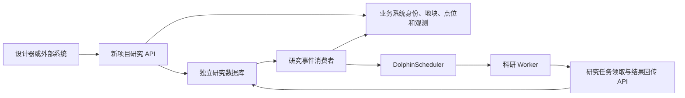

# 模型设计器独立项目改造计划

2026-11-11 · 旧系统基线已核对，首批设计服务已在 249 的独立研究库运行。目标是以独立项目承载设计器和研究服务，对外提供 HTTP API，并由 DolphinScheduler 执行研究任务。

## 交接约束

- 对外能力使用版本化 HTTP API，设计器和外部系统共用接口与服务端授权。研究任务由 DolphinScheduler 调度，保留外部 API 与 Worker 内部回调的身份边界。
- 权威组件目录保留准确代码、版本和合同摘要。使用 `available_for_new_design` 统一判断能否加入方案，参数表单读取 `research_contract.request_schema`。保留冻结定义、兼容历史 API 和旧方案 JSON，迁移中按实际调用方核对。
- 所有采集数据归属地块。`requires_sampling_points` 为真时，保存草稿、更新和发布版本前逐地块核验授权点位。实际启动再次核验当次选择。点位由业务系统维护，`unit_kind` 继续描述观测单位。
- 长势分析的报告覆盖范围与点位取样范围分别保留。NDVI 五档属于业务报告统计。点位株高与 NDVI 的配对仍需冻结点位、采样时间和影像证据，并用真实业务数据单独验收。
- 249 部署按全新项目交付。独立 PostgreSQL 实例、数据卷和研究库从空库初始化，目录由新项目制品登记。旧系统提供源码、合同和导出样例作为兼容依据。业务系统继续持有企业、地块、点位及观测主数据。研究规则、冻结数据及审计证据由新项目保存。
- 隔离验收与真实生产资格分别记录。实际海豚实例追踪、重发、取消、迟到回传和故障恢复须在真实调度的隔离环境复验。

旧项目文件链接用于追溯迁移依据。 [原迁移计划](<E:/CodexData/home/worktrees/enterprise-model-services/mlgrowth/coding/model-designer-extraction-plan-20261111.md>)

## 现状与证据

1. `mlgrowth` 的 FastAPI 进程同时挂载模型中心、研究服务和农业数据服务，也负责数据库迁移、目录同步和研究事件消费。设计器静态页面和 API 当前同源部署。API 镜像直接复制共享包源码，Worker 镜像从同一个根项目打包安装。 [应用入口](<E:/CodexData/home/worktrees/enterprise-model-services/mlgrowth/api/main.py>) · [API 构建](<E:/CodexData/home/worktrees/enterprise-model-services/mlgrowth/Dockerfile>) · [Worker 构建](<E:/CodexData/home/worktrees/enterprise-model-services/mlgrowth/dolphinscheduler.worker.Dockerfile>)
2. 研究实例按外键引用不可变方案版本，方案版本关联准确的组件版本。运行、观测修订、采集事件和科研模型发布也通过研究实例或运行关联。企业与用户隔离依赖 `resource_scope_id`、主体及数据库行级安全策略。业务系统负责项目、地块、点位及观测。 [方案数据模型](<E:/CodexData/home/worktrees/enterprise-model-services/mlgrowth/api/models/model_composition.py>) · [研究数据模型](<E:/CodexData/home/worktrees/enterprise-model-services/mlgrowth/api/models/research_studies.py>) · [科研发布数据模型](<E:/CodexData/home/worktrees/enterprise-model-services/mlgrowth/api/models/research_publications.py>) · [业务接入](<E:/CodexData/home/worktrees/enterprise-model-services/mlgrowth/docs/research-launch-api.md>)
3. 数据满足条件后，API 冻结输入并写入待投递事件。消费者通过 DolphinScheduler 提交固定 Shell 工作流，Worker 领取准确运行、续租、回传结果。采集规则、任务排队、科学运行和报告投递各有状态。 [运行冻结](<E:/CodexData/home/worktrees/enterprise-model-services/mlgrowth/api/services/research_studies/runs.py>) · [事件消费者](<E:/CodexData/home/worktrees/enterprise-model-services/mlgrowth/api/services/research_studies/runtime.py>) · [调度协调](<E:/CodexData/home/worktrees/enterprise-model-services/mlgrowth/api/services/research_studies/coordinator.py>) · [Worker 入口](<E:/CodexData/home/worktrees/enterprise-model-services/mlgrowth/src/pymlgrowth/research_models/remote.py>)
4. 当前企业分支以 `53d86cb` 为 HEAD，设计器、点位和报告有工作区改动。249 公开预览实查可读目录，选地、私有保存和在线启动显示关闭，私有研究列表返回 404。已有隔离用例使用实际数据库和 Worker，身份、业务端及调度提交使用测试替身。公开预览、隔离工程验证和真实调度验收各有独立证据。 [公开预览记录](<E:/CodexData/home/worktrees/enterprise-model-services/mlgrowth/docs/deployments/20261109-research-interaction-preview-249.md>) · [隔离验收范围](<E:/CodexData/home/worktrees/enterprise-model-services/mlgrowth/docs/deployments/20261105-research-workflow-249.md>)

## 拟定归属

| 归属 | 职责 |
|---|---|
| 新项目 | 模型设计器、对外研究 API、研究目录视图和来源采用规则、研究方案与版本、实例、采集规则、观测修订、运行状态、报告与科研版本管理。研究调度提交及回传接口由同一项目维护。 |
| 现有计算包与 Worker | 现有组件、科学算法、运行环境、准确输入和输出的校验与计算。DolphinScheduler 负责任务实际调度与执行环境。 |
| 平台与业务系统 | 企业身份、业务地块和点位、观测主数据及其他农业服务。平台组件目录保有组件定义和制品身份，新项目按准确版本读取，源码契约作为共享制品发布。 |

## 组件架构约束

组件开发规范是设计器、目录和 Worker 的共同基础。用户后续可自行提交组件，并在其权限范围内使用已通过验证和获准采用的准确版本。首个实现批次先用逻辑斯蒂组件验证下面的开发和接入约束。

- **开发模板。** 提供单一可复制的模板和一个可跑通的参考组件。固定交付结构包含版本化清单 `component.json`、独立入口与锁定依赖、构建说明、合成输入、预期输出、误差阈值及应拒绝样例。平台 CI 和组件开发者共用合同校验及样例复跑入口。沿用旧规范的端口语义、版本、形态、单位、时空对齐及值性质，属性表单由请求 Schema 生成。 [旧组件开发规范](<E:/CodexData/home/worktrees/enterprise-model-services/mlgrowth/docs/component-development-standard.md>)
- **版本和制品。** 平台目录登记获准的组件代码、准确版本、合同摘要及制品绑定，研究库保存冻结引用和采用依据。用户通过受权的候选入口提交清单与制品，平台核验供方、签名、摘要、依赖和许可，再在隔离环境按样例复跑。通过后按授权范围批准采用。新增同协议组件走登记与采用流程，验收时检查通用编排无需增加组件代码分支。停用应阻止新设计和新执行，历史方案仍可按原版本解释。
- **执行隔离。** 设计器和 API 处理声明与授权，Worker 按已登记制品和运行配置执行。用户制品初期以离线 CPU、单次调用作为拟定验收范围，使用独立执行环境、只读输入、限额输出及受控资源，拒绝未声明端口、越界路径、篡改摘要和超时。旧内置 Worker 路径继续供冻结版本兼容验收。正式自助上传、候选仓和隔离执行池按此边界另行验收。
- **自助接入验收。** 开放前用普通授权用户和一份独立开发的组件复跑从模板构建、上传、查看校验结果、获准采用、加入方案到执行取回成果的全过程。另用其他企业账号验证候选和私有组件隔离，验证同版本重传、冲突摘要拒绝、升级后旧方案仍解析旧版本，以及撤销后阻断新增使用。

## 独立数据库的引用边界

249 使用专属 PostgreSQL 实例和持久化数据卷，分别管理迁移角色和应用角色。首批空库初始化组件目录、资源范围、方案及版本相关表。研究实例、运行和科研发布按后续实现增加库内外键与约束。跨服务引用由受信 API 或版本化制品提供。

| 引用 | 新库处理方式 |
|---|---|
| 研究数据 | 新库保存草稿、方案版本、研究实例、观测修订、运行尝试、采集与报告事件、科研发布。保留历史 ID、幂等键、事件回执和已冻结摘要。 |
| 企业与用户 | 通过在线授权确认企业来源编号和用户主体。本地资源范围按 `company_source + company_id` 唯一映射，由新系统在业务写入时建立。所有者和租户策略通过原生低权限角色及强制行级安全验收。 |
| 组件和变量标准 | 平台目录继续发布权威定义。新库保留研究引用所需的确切版本和摘要，供库内外键、校验与历史回放使用。采用策略由新项目维护。校验旧方案时读取其冻结版本。 |
| 作物、地块和点位 | 作物校验优先复用平台目录接口，地块、点位和观测继续通过业务接口读取。研究库保留方案及运行需要的授权对象引用、数据修订和冻结证据。 |

现有耦合见[企业范围映射](<E:/CodexData/home/worktrees/enterprise-model-services/mlgrowth/api/services/enterprise/ownership.py>)、[组件和方案外键](<E:/CodexData/home/worktrees/enterprise-model-services/mlgrowth/api/models/model_composition.py>)、[变量来源外键](<E:/CodexData/home/worktrees/enterprise-model-services/mlgrowth/api/models/research_variables.py>)、[作物校验](<E:/CodexData/home/worktrees/enterprise-model-services/mlgrowth/api/services/research_launch.py>)及[现有作物接口](<E:/CodexData/home/worktrees/enterprise-model-services/mlgrowth/api/routers/crop.py>)。

## 问题清单

| 优先级 | 已核实的情况 | 改造与检查 |
|---|---|---|
| P0 | 预览批次、提交和工作区包含的内容不同。 | 先审定迁移基线，按范围记录源文件、数据库迁移版本、API 契约、夹具和制品摘要。用现有回归记录基线行为。 |
| P0 | API 和 Worker 通过旧仓库的打包布局共享契约和适配代码。 | 先让共享契约能按固定版本独立安装，显式打包组件和变量目录 JSON。新项目在干净环境构建，Worker 按同版契约复核旧方案、组件及成果摘要。 |
| P0 | 同源页面直接调用两个 API 前缀。私有研究按企业和用户授权，Worker 使用内部身份。 | 网页与外部系统统一使用研究 HTTP API，发布版本化 OpenAPI 和鉴权说明。沿用业务身份与用户委托，按路径隔离 Worker 领取、续租与结果回传。验收跨企业读写、项目撤权和原调用方兼容。 |
| P0 | 研究实例、组件版本和科研发布通过外键相连。企业范围和作物校验也依赖当前库。 | 为独立研究库建立迁移入口，验证空库初始化、库内引用、行级安全和准确组件摘要。历史配置以导出文件复跑。 |
| P0 | 现有调度适配器启动海豚实例后，只把工作流定义编号交回研究服务。 | 核实目标海豚环境实际返回的实例身份和查询条件。登记 `run_id`、执行尝试及海豚实例身份。提交超时后先核对已接受任务，再决定重投，实测成功后丢回执、重复提交和回传乱序。 |
| P0 | 现有取消撤销成果发布权，实际调度任务可能继续运行。 | 用目标海豚环境核实实例停止及确认语义。分别验证取消请求、进程停止、迟到结果拒绝，以及 Worker 失联后的恢复。 |
| P0 | 创建草稿和实例已有幂等键。当前运行请求省略 `cutoff` 时取服务器当前时间，运行复用会比较封存的时间。 | 对外运行契约明确重复请求如何复用首次冻结的时点和 `run_id`，区分有意重复实验。实测客户端超时重发和并发提交。 |
| P1 | 采集点校验已接入保存和发布。真实业务点位、数据接口和长势影像取值仍待联验。 | 迁移保存时的授权点位规则、来源代码、科学单位和地块归属。用点位缺失、补齐和撤权验证规则。株高与 NDVI 的取值及科学配对沿用独立验收。 |
| P1 | 目录可选、采集回执、数据就绪、调度接受、计算和报告交付已有不同语义。 | 外部 API 分别返回可观测状态及失败原因。缺数据沿用待采集流程，Worker 以同一封存输入重试，报告重投复用原报告。 |
| P1 | 公开预览和隔离工程测试已有证据，真实业务链路与海豚仍需联合验证。 | 在 249 用独立库、调度项目、队列和 Worker 环境验证数据就绪至结果回传，关联研究、运行和海豚实例。演练独立库备份、应用回退及任务恢复。 |

调度依据见[任务提交与启动](<E:/CodexData/home/worktrees/enterprise-model-services/mlgrowth/api/services/dolphin.py>)及[运行取消和重试](<E:/CodexData/home/worktrees/enterprise-model-services/mlgrowth/api/services/research_studies/runs.py>)。点位与长势数据依据见[长势分析变量记录](<E:/CodexData/home/worktrees/enterprise-model-services/mlgrowth/coding/research-growth-trend-variable-inventory-20261110.md>)。

## 实施顺序与验收

1. **审定旧系统基线。** 已记录提交、工作区源码指纹、预览实测及隔离验收凭据。迁移对照采用固定的 V3 历史样例和 V4 当前候选样例。 [源码与回归映射](model-designer-baseline.md) · [研究库迁移清单](model-designer-data-migration.md) · [首批复跑用例](model-designer-first-batch-acceptance.md)
2. **建立独立数据库和组件开发模板，迁一个设计闭环。** 新项目独立安装共享契约，提供版本化 API。在 249 的空研究库按模板核验参考组件，导入两版逻辑斯蒂样例，比较组件绑定、方案摘要和租户权限。跑通组件查询、校验、保存、重开和发布，另用点位方案验证缺点位拒绝、补齐通过和撤权复查。用原生非特权角色测试跨企业隔离。
3. **接真实海豚并完成一个研究闭环。** 在 249 用固定输入从对外 API 发起，生成采集规则、读入合格观测、冻结运行、经真实海豚启动 Worker、查询成果。验收至少包含同一请求重放、提交回执丢失、Worker 失联、取消与迟到结果。同一输入的算法结果按旧行为和既有误差口径比较。
4. **补齐其余功能并接入调用方。** 按清单交付其余模板、组件入口、实例状态、报告和科研发布。校验外键、摘要、企业隔离、事件回执和待处理记录后，调用方可通过版本化 API 发起新研究。应用回退沿用独立研究库及相容迁移版本，恢复时验证新库写入、事件回执和运行归属。

步骤 2 已交付首批设计服务与组件模板。249 空库迁移、低权限角色登录、API 和 V3/V4 配置样例已验证。原设计器页面、真实企业授权、业务观测和调度按相应阶段复验。 [实现与本机验收](design-service.md) · [249 部署记录](deployments/modarchitect-249/README.md) · [真实调度验收](model-designer-dolphin-acceptance.md)
