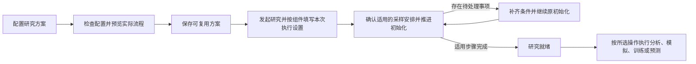

# 后续采样计划和研究初始化设计

2026-11-18 更新。飞书《模型设计器的修改》确认本期到方案检查、保存和回读。本文保留发起研究时配置采样与调度参数的后续设计。[本期改造与验收](model-designer-phase-20261118.md) · [平台规则](../docs/platform-rules.md#初始化步骤与进度)

## 交付终点

保存方案时保留组件、指标来源、单位、采样尺度、采集和评价要求。进入“发起研究”时，平台根据准确方案和实际操作给出本次必填项。地块、样点、作物、周期、执行频率、触发窗口和具体采样人员按需填写。方案负责编制和复核的负责人沿用既有基本信息。

发起研究时可以先登记初始化，暂缺对象或授权时保留待处理事项。具体采样计划在所需条件齐备后确认，具备投递条件的自动任务由 DolphinScheduler 执行。具备资料的单次分析或模拟可直接进入已有执行入口，需要补充实测的研究先采样，再按实际数据满足情况启动训练。保存成功的训练模型可沿用既有预测入口。对外发布属于单独的验收目标，若本期要求外部调用，需追加发布版本、使用授权、预测接口和发布门禁。当前发布能力边界见[模型发布设计](research-template-inputs-and-model-publication-review.md#七模型对外发布复用制品增加发布与授权边界)。

## 修改清单

| 顺序 | 改造内容 | 可复用能力及缺口 |
| --- | --- | --- |
| 1 | 检查与确认页用当前草稿生成动态流程，节点可查看或返回配置，问题可定位 | 复用03/06目录、09/10配置生成及检查、11/12保存、14重开。图由实际端口及依赖生成。方案检查、启动预检和本次资料状态分别显示。 |
| 2 | 保存可复用方案并说明发起条件 | 从组件要求、实际外部指标和评价设置派生采集需求。设计页可展示采集方法、尺度、最低有效观测及运行时所需信息，执行频率、日期范围、启用状态和实际人员在发起研究时填写。复用原保存和回读接口。已有方案的间隔等字段保留历史解释，可作为发起时的建议值或原合同的约束。 |
| 3 | 发起研究时生成表单、预览和确认本次采样计划 | 按实际操作和组件推导哪些地块、样点、作物、周期、频率及人员需要填写。复用业务选地与核权、来源目录和观测模板，保存准确方案版本、已核验的对象和实际执行安排。仅在所需来源支持相应触发方式时提供选项。气象日值、卫星实际场景和静态土壤参考按各自数据约定执行。 |
| 4 | 按实际依赖执行和持久化初始化 | 复用方案冻结、组件能力检查、地块核权、来源登记和现有调度。按需增加业务表单映射核验、外部来源实例引用、采集任务初始化等步骤。只挂本次需要的步骤。逐步记录证据及状态。等待授权或对象时，有条件的步骤可继续。失败或补齐后的续跑使用原记录，提交和恢复均按幂等规则处理。 |
| 5 | 提供业务后端可转接的状态和操作，接入真实执行 | 两端从同一初始化详情读取步骤、依赖、状态和待处理操作，支持离开、重开、刷新与继续。就绪后衔接对应的单次运行或持续报告，并可查询结果。采样触发与当前凌晨 2 点的报告触发分别管理，非采样日和应采未采分别处理。 |

接口沿用现有企业 API-Key、企业范围和已有资源引用。新增接口围绕发起字段、执行计划预览与确认、初始化查询和补齐后续跑。确认时复验准确修订、采样参数与对象授权，保存本次计划，再由适用的初始化步骤提交任务。历史结果继续引用原版本。来源凭据继续由服务端或 Worker 的授权接入管理，页面使用来源引用和授权状态。初始化详情只提供身份、准确引用、状态、实际完成数、适用总数、步骤依赖及可处理缺口。页面按平台给出的计数计算百分比。计算节点实时进度若纳入页面，需有单独的运行事件证据，现有最终结果回执可继续用于回看。

## 验收条件

1. 通过业务接口打开模板和自定义方案，检查错误定位到具体步骤。合法配置可以在尚未选择地块、样点及采集频率时保存和重开。保存时无采集或海豚任务。用同一方案在不同对象和周期上发起研究时各自保存本次执行设置。
2. 纯气象分析只生成实际需要的发起字段和初始化步骤。点位实测确实被当前操作用到时才要求选择授权样点。土壤、气象、卫星和人工实测的组合分别解释获取规则。每 7 天采样的日期可核对，非采样日与应采未采状态可区分。
3. 同一初始化缺来源授权或对象时显示可定位的待处理事项。其他已满足依赖的步骤继续运行。补齐后能重查和继续，重开页面仍能看到已记录进度，重复提交及重试只产生一份有效计划和对应任务。修订过期和越权请求被拒绝。
4. 在隔离环境用一个实际可用的分析方案验证从确认、初始化、启用到调度和结果查询。用一个已有训练方法验证按当前资料条件进入待采样或训练路径，并在有合格数据时验证保存模型及受权预测。未接入的来源或制品以明确待补状态验收。
5. 业务与前端文档按实际接口补齐请求、响应、状态字段、错误定位和最小调用示例。注明配置通过、初始化就绪、研究已启用、计算完成和模型已发布各自的证据。

## 当前实现依据

- [设计保存闭环](api-design-loop.md)与[动态流程总览](research-flow-overview-20261117.md)已具备检查、保存、回读和按准确依赖展示的基础。
- [采集要求合同](../modarchitect/contracts/research/plans.py)已包含来源、方法、对象层级及部分时间规则。[持续报告实现](continuous-research-implementation.md)目前对人工观测要求当日覆盖，每周采样需单独建立采样日历和对应的缺测判断。
- [业务正式保存](../modarchitect/designs.py#L160)已经可独立保存方案。既有个人工作区保存及版本发布路径仍可能提前核对点位，现有技术配置也能编辑间隔。改造时须核对这两处，保留历史行为的兼容入口，将新流程的具体点位核权和执行参数设置放在研究发起阶段。
- [现有执行接口](../modarchitect/runtime/routes.py)已有个人工作区执行预检、持久化运行和模型复用。初始化与企业对接需要新能力，现有运行结果中的节点回执在任务完成时返回。
