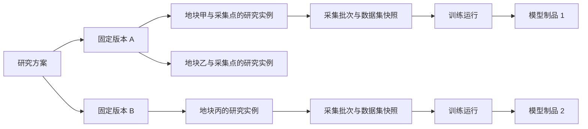

# 研究方案应用与版本身份

2026-11-18。本文记录 0013 之前的核查结论和后续实现方案。

## 实施入口

- 保留 0012 已登记的本地草稿证据，0013 起草稿只存候选版本名称。实际版本名称分配和唯一约束移到 `research_design_versions`，数据库按确定的 UUID 对外关联。自动名称从当前固定版本的序号分配，遇到人工已用名称则跳过。正式保存入口沿用既有发布 API，允许计划先冻结，运行条件在应用计算时再查。
- 普通应用沿用业务选地授权和个人工作区使用规则，通过 `/studies` 保存不可变应用上下文。采集、数据集和训练通过 `/studies/{study_id}` 下属入口使用冻结计划。已有日报任务沿用其 UUID 作为同一研究实例身份，并在既有事务中写入公共实例记录。新产生的采集、数据集和运行落库时带实例引用和必要外键，旧记录仍可按原有接口访问。
- 准确训练引用一个已封存数据集。既有模型表通过 `run_id` 追溯实例、版本和样本。新入口要求应用上下文、数据集及来源快照归属一致；旧设计器试跑入口保留既有协议。

## 0013 之前的实现核查

| 环节 | 代码和数据库事实 | 影响 |
| --- | --- | --- |
| 草稿与版本名称 | 11/12 把最新草稿和保存回执原子提交。本地 0012 把展示编号和配置摘要登记在 `research_draft_versions`，数据库按 `design_id + version` 检查名称重复。记录只关联草稿修订。 | 编号可以回读，编号本身无法定位可应用的快照。单改编号产生新草稿修订，发布仍可返回原 UUID，发布回读也没有该名称。 [保存](../modarchitect/designs.py#L163) · [本地登记表](../modarchitect/persistence/schema.py#L84) |
| 固定方案版本 | `research_design_versions.design_version_id` 已使用 UUIDv7。`research_design_components` 关联确定的组件版本，数据库触发器保护发布记录；方案版本与草稿分别计算修订。 | 系统间可沿用现有版本 UUID。历史任务和运行引用的 UUID 应继续保留。 [发布](../modarchitect/designs.py#L195) · [版本写入](../modarchitect/persistence/design_store.py#L380) · [不可变约束](../modarchitect/persistence/migrations/versions/0001_design_catalog.py#L55) |
| 应用与每日任务 | 创建日报要求 `design_version_id` 和应用范围。数据库用组合外键检查方案与版本归属，保存应用对象及固定定义。每日报告批次从任务的固定定义生成采集表、采集任务和计算运行，批次按任务与观察日期唯一。 | 已建立的日报继续按旧版执行。不同对象可以同时应用同版或不同版本。 [应用](../modarchitect/report_tasks/service.py#L124) · [日报存储](../modarchitect/persistence/report_store.py#L37) · [批次准备](../modarchitect/report_tasks/service.py#L352) |
| 单独采集、数据集与训练 | 普通采集入口使用 `design_id + expected_revision`，校验后封存本次取数请求。普通数据集创建有按 `design_id` 读当前草稿的入口，数据集快照在库中只关联 `design_id`。单次训练从选定草稿修订准备并发布后，运行才绑定 `design_version_id`。 | 已排队的采集及计算有自己的封存输入。通过普通入口串起长期研究时，保存的各项资源缺少共同应用身份及数据库版本归属约束，后续组装可能采用当前草稿。 [普通采集](../modarchitect/input_sources/service.py#L48) · [数据集创建](../modarchitect/datasets.py#L86) · [数据集存储](../modarchitect/persistence/dataset_store.py#L30) · [训练](../modarchitect/runtime/service.py#L160) |
| 训练模型与预测 | 已保存模型通过 `run_id` 指向训练运行，训练运行持有准确的方案版本 UUID。单次预测按 `model_id` 回溯训练运行。日报预测目前还通过比较计划正文判断模型与方案相容。 | 训练结果按次独立保存。同配置的方案可训练出不同模型。实例内使用模型应比对明确的版本和模型身份，跨实例采用须有明确选择和适用性依据。 [模型存储](../modarchitect/runtime/store.py#L72) · [预测](../modarchitect/runtime/service.py#L200) · [日报模型检查](../modarchitect/report_tasks/service.py#L162) |

## 同一方案如何被多次应用

| 实体 | 数据身份与约束 |
| --- | --- |
| 研究方案 | `design_id` 标识长期维护的同一方案。草稿有自己的编辑修订，供并发保存校验。 |
| 方案版本 | 沿用 `design_version_id` 做主键。固定方案配置、指标和采样规则、组件版本、评价规则及摘要。展示用 `version_name` 归属此版本，同一 `design_id` 下唯一；支持简短自定义名称，留空按平台序号分配。人工名称不参与顺序计算或科学合同摘要。 |
| 研究实例 | 记录准确版本 UUID 及业务对象、点位、种植季、观察期和采集安排。使用现有日报任务承载每日应用。普通应用补足对应的实例引用后，采集、数据集和运行可以查明来自哪一次应用。 |
| 采集、数据集与训练 | 采集依据应用时固定的指标、来源及点位。数据集保存样本范围、来源和封存摘要。训练绑定实例、准确版本和本次数据快照，模型沿训练运行回溯这些身份。预测显式选模型制品。 |

## 保存、应用与变更

1. 继续使用草稿保存和修订检查，确认前可编辑候选版本名称。用户选择保存为可应用版本时，由方案服务统一核验并固定准确配置，在同一事务内登记 `design_version_id` 和版本名称。前端和业务系统使用同一个固定版本入口。设计配置完整和目前可执行分开判断，发起应用时再查实际来源、执行制品、权限和数据条件。原保存回执仍可重放，应用只接受准确版本身份。
2. 启动时绑定具体范围及采集安排。一个版本可应用多次。编辑方案只更新草稿，确认新的应用版本后新增快照。旧研究即使补跑、在旧运行后补数据或继续采样，也按其原版本解释记录。新版只在调用方显式选择时用于新的应用。
3. 旧地块需要切换新版时，按生效日期新建实例，明确旧实例停止覆盖的日期，检查默认日报重叠。旧批次、失败重试、观测记录和模型保留原引用。并行对照实验可以由业务显式发起两个应用，以实例区分系列和结论。
4. 获得不同模型取决于实际训练。相同方案版本在不同作物、季节或采集周期训练时，仍生成独立运行和模型制品。需要跨版本沿用观测或模型时，通过受权的显式复用操作重新检查指标、单位、来源、采样层级、数据范围和模型适用性，并记录原证据与采用关系。

## 数据迁移与代码职责

- 方案服务单点处理版本分配、内容冻结和保存幂等。版本名称与 UUID 存于同一准确版本的记录体系。复用现有 `research_design_versions`；上一轮本地草稿编号登记不作为应用版本表。
- 持久化约束版本名称在同一方案内唯一，并校验实例接受的版本属于该方案。对新增业务采集、数据集和运行使用可追溯的实例关联。模型继续复用训练运行外键，避免再存互相矛盾的版本引用。
- 运行模块从实例加载准确版本和已封存数据。旧的便捷设计器入口可以继续按准确草稿修订构造一次性运行。已经应用的任务使用固定版本执行路径。最新版本查询只用于选择或展示。
- 保留已上线版本 UUID、内容摘要、既有任务和模型历史。对旧版本补显示名称时以准确版本记录为依据。历史采集能从任务和批次确认归属时再建立关联，其他记录保留为历史资料，不能依据方案 ID、当前草稿或碰巧相同的修订整数推断版本。

## 验收条件

- 版本 A 应用于两个地块，第三个地块明确采用版本 B。编辑期间触发旧日报，核对每个批次的版本、对象及人工采集列。重试、补跑与新版本应用并发时核对相同证据。
- 两个版本使用各自的数据快照训练。保存并重开两个模型后，从模型回查训练运行、应用实例、数据范围和准确方案版本。以模型 A 做预测仍使用 A 的准确训练状态。不同实例的来源证据不可隐式混入。
- 检查换名、同一方案撞名、不同方案同名、保存回执重复提交、历史任务恢复及跨企业读取。升级前后每条已发布版本的 UUID 与摘要相同。

## 改造前核对证据

在独立 PostgreSQL 库里通过现有 HTTP 入口回放了两版方案。先用版本 A 为地块甲启动任务，再把第二个采集项由冠层覆盖度换成地上生物量，发布版本 B 后为地块乙启动任务。同一个逻辑业务日生成两个批次，甲继续要求叶面积指数和冠层覆盖度，乙要求叶面积指数和地上生物量。还复现了在原科学定义上只改草稿编号时，发布返回原 UUID，发布响应缺少草稿编号。

上述用例与既有的多因素和串联训练、保存模型、重开与预测用例一并运行，3 项通过。验收由本地 HTTP/测试 Worker 驱动，使用模拟的调度就绪检查和验收样例。普通采集与数据集的跨实例约束属于待实现项。部署环境服务和数据库在本次核对中未变更。

## 0013 与 0014 的实现和验证

- 0013 给 `research_design_versions` 增加人可读名称和方案内唯一约束。草稿只提供候选名称，确认保存生成或复用准确版本。老快照保留原 UUID 和科学合同摘要。使用 `POST /design-drafts/{design_id}/publish` 固定，使用 `GET /design-versions/{version_id}` 回读，原 11/12 保存回执仍为三字段。
- 0014 增加 `research_studies`。普通应用固定授权对象、采集点和观察期。已有日报以原 `task_id` 建立研究实例记录。新产生的采集、数据集和运行通过外键关联所属实例；运行同时约束版本和数据集。历史完成的批次仍沿原任务、批次、运行以及数据集外键解释。
- 隔离 PostgreSQL 中通过 HTTP 完成两版方案的独立训练、保存模型及重开，从两个模型回查各自版本、地块和数据集，验证旧模型仍可预测且拒绝跨实例提交。业务来源用例通过可信网关及气象服务的测试替身，核验点位归属，按地块参考位置完成气象采集，封存天气与人工观测后训练并保存模型。
- 以旧发布包和 0011 隔离库创建旧任务，然后升级到 0014。确认原版本 UUID 与摘要一致，原日报任务 ID 仍可作为研究实例查询，按原观测列补跑并成功完成计算。Alembic 元数据比较无剩余差异。
- `.venv/Scripts/python.exe .ops/verify_local_database.py` 选跑版本实例、设计、业务保存、采集、日报、数据集和运行的 75 项后端回归；最终的版本与实例专项 3 项复验通过。`npm test` 通过 121 项。24 个自有 Python 文件通过文件头和 Ruff 检查。

0014 的上述执行验证使用标准地块种植季观测表和隔离测试 Worker。点尺度资料可在业务实例核验及固定点位，运行和训练仍由具备对应科学尺度的适配器提供。

## 0015 上线兼容

迁移期间 API 滚动切换，旧进程仍可能发布方案或创建日报。数据库统一分配缺省版本名称，旧进程省略名称也遵循同一规则。日报写入时由数据库事务保证存在同 ID 的研究实例，已有实例直接复用。发布端继续校验显式名称和授权，模型及任务历史保留原身份。

验收覆盖旧发布包在 0015 隔离库写入固定版本与日报，以及新版回读同一版本 UUID、合同摘要、自动名称和研究实例。实际调度完成合成数据训练、保存和预测。真实采样点取数及点尺度训练待联验。
