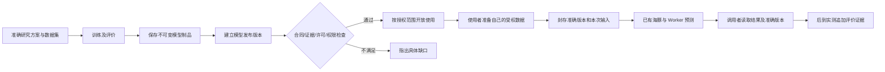

# 研究方案输入审计、土壤天气联合研究与模型发布设计

2026-11-13。状态：**已完成只读审计与设计，尚未实施本报告提出的改造、三项新研究或模型对外发布。**

本报告以当前独立项目和 249 实际服务为依据。先解决研究方案的准确输入，再做可运行的联合研究，最后开放准确模型的受权使用。原组件模板、版本化合同、不可变来源及 DolphinScheduler 调度继续保留。

## 一、结论与需要纠正的判断

用户指出的问题成立。“逐日气象数据”目前确实是一个打包端口名称，不能单凭这个名称确定指标、单位、来源、日期或完整性。它不是已经完成系统指标映射的研究配置。

1. 当前 **16 个公开研究主题、18 份方法配置**中，只有“多因素作物生长指标预测”和“田间观测指标汇总与比较”逐项绑定了系统目录。其余公开主题中，13 个使用固定资料包，1 个仍是私有变量的合成串联演示。隐藏的 RF 替代方法 XGBoost、GP 也使用固定资料包。**资料包有摘要、能运行，不代表其中每个指标已接入系统目录。**
2. 上轮验收证明了 18 项第三方指标取数，以及“日均温 + 日太阳辐射 → 工程构造 LAI 标签”的训练和预测；**并未证明土壤因素参加了训练，更没有证明所有现成研究方案已经改用系统来源。**依据：[实际验收](deployments/modarchitect-249/source-inputs-acceptance.md)、[复跑入口](../scripts/verify_source_research.py)。
3. 土壤天气联合研究不能只给原单地块表加几列土壤。单地块同一像元的静态土壤属性逐日重复，和现有线性回归的截距共线，不能辨识土壤系数；现有实现会拒绝秩不足。当前来源装配又限制同一指标恰好一个快照，阻止了多个地块的正常联合训练。这两处都必须先处理。
4. 当前“保存模型”是工作区内登记准确训练制品，尚没有让其他人使用的发布版本、授权范围与外部调用入口。方案版本、训练模型、模型发布版本需要分别管理。
5. “更新到什么时候”至少要分清训练样本覆盖、资料取得、训练完成、评价覆盖和发布时刻。不能只显示一个 `updated_at`，更不能把今天抓到的旧资料称为“模型已学习到今天”。

## 二、本次到底检查了哪些内容

证据文件：[逐项机器审计](research-template-audit-20261113.json)。公开服务 18 份当前配置的准确摘要与仓库一致，四个工作区示例内容也一致。采集时间记录为带时区时间戳；北京时间为 2026-11-13。

| 范围 | 数量及结果 |
| --- | --- |
| 公开研究主题 | 16 个，全部逐项列于下一节 |
| 当前方法配置 | 18 份，包括未单独列卡的 XGBoost、GP；15 份是资料包路径 |
| 工作区示例入口 | 4 个；`system`、`analysis` 有四项标准人工绑定，`multivariable`、`chain` 仍无系统绑定 |
| 历史模板 | 两份归档各 10 条，共 20 条记录，准确身份及端口列入证据，不改写原版本 |
| 库中已保存草稿 | 138 份，47 种科学定义；36 份目录观测、30 份未绑定观测、72 份资料包 |
| 库中已发布方案版本 | 116 份，44 种科学定义；25 份目录观测、16 份未绑定观测、75 份资料包 |

这些存量包括工程验收、合成演示与历史资料，**数量不代表有这么多正式农业研究**。审计覆盖每条持久化记录，证据按身份和修订保留分类，没有导出原始观测、主体凭据或私人训练数据。

用当前普通研究绑定规则检查，30 份未绑定草稿、16 个未绑定历史方案版本会被拒绝，这是缺少真实输入资格的提示，不意味着应修改其历史内容。资料包由于没有采集要求，基础绑定校验可能返回成功；这也**不能**作为完成逐指标来源审计的证明。旧资料包须按准确原生合同解释，新研究应产生新模板修订或明确的新研究副本。

审计入口与调用链：[模板读取和输入策略](../modarchitect/study_templates.py)、[预检/启动准备](../modarchitect/runtime/preparation.py)、[来源规则](../modarchitect/system_inputs.py)、[页面指标展示](../modarchitect/web/designer/modeling.js)、[流程图回退显示](../modarchitect/web/designer/research-flow.js)、[模板回归](../tests/test_study_templates.py)、[农业组件回归](../tests/test_agronomic_research.py)。

## 三、所有现成方案的逐项整改清单

下表“应明确的输入”是整改要求。**可映射**表示存在科学含义相符的目录条目，不表示该方案目前已完成取数和原生端口适配。正式绑定一律使用准确版本、摘要、方法与属性，不凭中文同名关联。

| 研究主题 / 方法 | 目前的准确情况 | 应明确的输入及整改 |
| --- | --- | --- |
| 多因素作物生长指标预测 | 四项系统人工指标已绑定；默认冠层覆盖度、块茎干物质为 X，LAI、地上生物量为 Y；附合成数据 | 显示四项准确单位、训练/应用用途和人工记录要求。块茎干物质需要破坏性采样，并非轻易可知的未来因素；限定马铃薯用途，不能用“通用作物”暗示适用于番茄。明确为给定因素估计，不能默认为提前预测 |
| 生长趋势与环境因素联合预测 | `day/height/ndvi/soil_water/temperature` 无系统绑定；`prior_height` 是上游派生量 | `height` 不能直接改名为地块株高：目录株高是点位尺度，缺点位装配；NDVI 平台来源仍缺正式接入；逐日实际土壤水分不能映射为 SoilGrids 固定吸力持水量；`day` 要由种植日期按方法派生。来源和尺度补齐前保留演示身份 |
| 田间观测指标汇总与比较 | 四项人工指标均已绑定，但默认统计只选 LAI、冠层覆盖度 | 明确“实际分析 2 项”和“尚未用于计算 2 项”；支持按合同增删统计指标。不让上传的额外列被误认为已经参与比较 |
| 温室作物耗水估算与称重对照 | 三份固定合成请求；只在方案变量中出现净辐射、耗水两个占位量 | 列清温室气温、净辐射、土壤热通量、VPD、饱和水汽压曲线斜率、湿度计常数、称重小时记录、灌溉/排水、作物系数及非胁迫证据。区分观测、参数和派生量；室外短波辐射不能充当温室净辐射，暂列方法示例 |
| 冠层温度与环境因素关系研究：RF | 固定合成表格：一个气温因素、一个冠层温度目标；单株尺度 | 显示真实因素数、冠层温度目标、时刻和样本划分。现系统缺相应温室/单株资料接入；不能用地块日均气温替代瞬时单株输入。当前运行是分析/留出预测，不应声称保存了可调用预测制品 |
| 同一主题：XGBoost（隐藏方法） | 与 RF 相同的固定合成输入 | 共用同一准确输入合同及划分，仅变方法；不漏审隐藏选项，不假装增加一种算法就补全来源 |
| 同一主题：GP（隐藏方法） | 与 RF 相同的固定合成输入 | 同上；另按真实输出声明不确定性，没有输出就不承诺区间 |
| 冠层温度短期预测研究：LSTM | 固定三步序列，提前 3600 秒，单株尺度 | 明确每步时刻、采样间隔、已知截止、1 小时目标和窗口划分；不能用日值替代小时序列；需要可复用训练状态和真实预测操作合同 |
| 冠层温度空间分布预测研究：ConvLSTM | 固定三步网格序列，提前 3600 秒，样方尺度 | 在上一项基础上明确 CRS、范围、分辨率、配准、有效掩膜和像元覆盖；不能把点位表改名为影像序列 |
| 生育期低温与霜冻条件分析 | `weather` 固定资料包；只可改作物、截止日期 | `temperature_minimum_daily`，°C，近 7 个上海业务日；沿用准确低温规则及覆盖政策。地面/冠层温度不能与 2m 气温混同，不能据此确诊冻损 |
| 生育期高温条件分析 | 同上，规则为 `heat_exposure`；没有系统采集要求 | `temperature_maximum_daily`，°C，近 7 个上海业务日；来源为当前获准的历史网格天气。明确 35°C 为当前规则阈值，不把它宣传为所有作物、所有生育阶段的科学阈值 |
| 降雨不足与水分供应条件分析 | 固定天气包；规则没有接收额外土壤/水分输入的公开端口 | `precipitation_daily`，mm，近 30 日完整窗口。若要讨论水分供应，另定义灌溉、实测根区含水量或准确模拟成果；当前 SoilGrids 持水量不能证明当日缺水 |
| 强降雨与积水条件分析 | 固定天气包，近 7 日规则 | `precipitation_daily`，mm，近 7 日；是否触发与资料覆盖分别输出。现规则 50mm 为参考条件，积水还需地形/排水/田间证据，不能只换标题就声称算过积水 |
| 温湿条件与病害风险分析 | 固定天气包，实际规则需要日均温、降雨、VPD | 可映射日均温和日降雨；**VPD 目前没有这 18 项接入中的同义指标**。`vapour_pressure_daily` 是水汽压，不是饱和水汽压差。需独立、获准且可复跑的 VPD 派生方法或新来源；缺它就指出具体缺口，不能用水汽压代填 |
| 耕层土壤理化特征分析 | 固定旧资料宣称 0–30cm；7 个旧指标名和原生单位 | 分别映射 `soil_phh2o/soil_soc/soil_bdod/soil_cec/soil_clay/soil_sand/soil_silt`。必须选具体原生土层。现目录没有直接的 0–30cm 层：如需合成，另有厚度、质量或储量相应的科学聚合方法，pH 等不能无依据统一算术平均。容重 kg/dm³ 与 kg/m³须准确换算 |
| 植被指数时序变化分析 | 固定两期 NDVI 区域均值 | 明确 NDVI 来源产品、区域、日期、云/质量、聚合方法与覆盖；平台分析正式取数仍缺接入。区域均值不替代采样点 NDVI，两期差值不是训练模型 |
| 作物生长与水分限制分析 | 固定 WOFOST 情景的水分胁迫、LAI、土壤含水量、地上干物质 | 来源应为准确模拟运行的四项产物，保留情景、模型、参数和种植季；这是上游派生输入，不绑定成人工实测，也不能暗示当前方案重新运行了 WOFOST |
| 产量形成与干物质积累分析 | 固定 WOFOST 储藏器官干物质、地上干物质、生育进程 | 明确三个准确模拟指标及上游运行；不等同于实收产量、鲜重或品质。需要新增模拟取数/串联时显式连接准确上游产物 |

天气窗口与阈值核对的是原规则准确源码：[规则政策](E:/CodexData/home/worktrees/enterprise-model-services/mlgrowth/src/mlgrowth_contracts/survey_risk_policy.py)、[闭区间及逐字段质量](E:/CodexData/home/worktrees/enterprise-model-services/mlgrowth/src/mlgrowth_contracts/survey_risk_windows.py)，旧库只读。当前独立组件引用规则第 4 修订，整改还需针对部署制品独立复跑，不能只依据旧源码文本改变历史合同。

### 高温方案应怎样让研究人员看懂

以截止日 2026-11-02 为例，输入卡应该直接列出以下事实，不能要求用户自己解释“逐日气象”。

| 研究人员看到的内容 | 准确要求 |
| --- | --- |
| 研究指标 | 日最高气温，单位 °C，作为条件分析输入；不是预测目标 |
| 研究对象 | 具体地块、作物和种植季；参考点及网格支撑可展开查看 |
| 研究日期 | 2026-10-27 至 2026-11-02，含首尾 7 日，Asia/Shanghai |
| 资料来源 | 准确版本的 Open-Meteo 历史网格资料，估计性质，不称为田间实测 |
| 本次覆盖 | 已取得的日期、有效日数、缺失/不合格日期；目录存在不代表本次就绪 |
| 计算规则 | 当前规则为最高温达到 35°C 的参考条件，并保留规则版本 |
| 可调整内容 | 地块/季节/日期与已获准来源；阈值或方法改变形成准确方法修订 |
| 输出 | 条件是否触发、窗口覆盖、证据日期及解释范围；不是病害概率或预测模型 |

“生育期”当前只有作物代码和截止日期，并没有生育阶段输入或分阶段阈值。首期应改为**作物高温暴露条件分析**，或补齐真实阶段、依据和相应规则后再保留“生育期”的具体含义。原规则对高温/低温/强降雨可给出部分窗口的阳性条件信号，少雨及温湿规则有不同完整性要求，不能一概改成“缺一天就阴性”或一律当作完整窗口。

Open-Meteo 官方说明历史产品使用再分析/模型资料，并不是当地气象站实测。SoilGrids 官方说明其为空间预测产品，固定吸力含水量与时变实际土壤含水量也不是一个量。[历史天气产品](https://open-meteo.com/en/docs/historical-weather-api)、[SoilGrids 产品与尺度](https://docs.isric.org/globaldata/soilgrids/SoilGrids_faqs.html)、[属性、单位和土层](https://docs.isric.org/globaldata/soilgrids/SoilGrids_faqs_01.html)。

## 四、统一规则：配置、展示和执行必须来自同一份定义

### 1. 沿现有合同补全，不另建一套“页面输入清单”

普通外部输入继续从 `collection_requirements.catalog_binding` 读取准确指标、方法及来源属性；节点用途从实际绑定推导；日期窗口/阈值来自版本化方法合同；本次覆盖从受权数据集读取。界面只投影这些事实，不手写一份可能与实际算法不同的指标表。

资料包不能一律压成地块日值。原生序列、网格、称重和模拟产物按原生合同列清内部输入，使用系统指标引用或准确上游成果引用；缺相容定义就报告缺口。只补说明文字不能让其获得真实研究资格，也不能给未知资料编造变量或来源。

目前 `configure_input()` 固定生成 `required_for=(train,)`。新分析、模拟或预测配置应按真实操作生成要求，不能让“高温分析”继续带只有训练用途的默认声明。复用变量和来源定义，不复用错误的阶段假设。

### 2. 所有研究入口使用一致门禁

| 状态 | 平台行为 |
| --- | --- |
| 有准确指标定义，但没来源通道 | 可以保留草稿；显示具体未接通项；不把选择成功显示成取数成功 |
| 有通道，但本次缺资料/尺度不符 | 显示缺哪些对象、日期、土层或单位适配；阻止相应运行 |
| 使用固定方法示例 | 明确示例身份及可编辑范围；不得提示“替换为自有数据”而实际拒绝替换 |
| 采用真实自有研究 | 系统目录绑定、科学支撑、来源快照、准确方法、数据覆盖全部校验 |
| 用户新增/删除/替换输入 | 同步节点因素、目标、方法与资料；额外未使用列明确提示，不计入模型输入；缺必需项定位到指标和用途 |
| 上游派生产物 | 读取准确运行、输出端口及变换，保留 simulated/estimated 等性质；不伪装外部观测 |

输入清单可以最小化投影为：指标引用、节点用途、来源绑定及所需范围。名称、单位、来源说明按引用展开；数据集就绪另读，不将实时状态写回模板定义。原 `collection_requirements`、用途和来源快照各有归属，不追加一组重复 `is_ready/is_real/is_trainable` 布尔字段。

固定资料包继续兼容按原摘要复跑；新版本改成动态来源装配时，追加新模板修订和必要的新组件修订，旧 JSON、参数含义和制品摘要不覆盖。

## 五、先补齐土壤天气联合研究真正需要的能力

### 已验证的三个阻断点

1. **多地块取数与来源装配。** [页面](../modarchitect/web/designer/source-data.js)明确只支持一个地块种植季；[服务端](../modarchitect/system_inputs.py)对同一绑定要求恰好一个快照，而[采集请求](../modarchitect/input_sources/contracts.py)每次只有一个对象。把各地块表拼起来仍会在来源核对时失败。
2. **单地块土壤系数不可辨识。** [现有线性回归](../components/multivariate_regression/component.py)包含截距并检查满秩。土壤列在单地块日序列中为常数，不能靠增加天数学习其独立作用；也不能为了“跑通”删除秩检查。
3. **评价只按时间截止。** 现有线性组件以 `training_end` 划分。现有方案的一些评价字段能表达独立单位，不代表本计算入口已经执行了分组训练/评价。联合模型要验证新地块，必须准确实施地块/空间分组和时间留出，而不是在 UI 上打一个“独立验证”的标签。

### 最小可行改造

- 采集仍以准确单对象请求工作；允许一个准确指标在研究数据集中由多个受权快照覆盖不同对象/日期。按完整对象 + 业务日期 + 指标绑定匹配；无覆盖、相互冲突、重复记录、跨主体引用均拒绝。重复的相同静态土壤记录仍只算一个支撑单元。
- 在现有研究输入封存上补**准确数据集快照**：保存多对象装配清单、来源引用及数据摘要。新调用只传该快照身份，避免不断扩大最多 36 个来源 ID 的请求数组；旧接口及已保存来源引用保留兼容入口。这是明确的实施建议，不是当前已有能力。
- 统一划分计划先确定，再拟合预处理/派生训练状态。针对新地块用途，空间/地块组之间保持隔离；针对同地块后续日期，采用时间留出。共享土壤像元或天气网格带来的依赖要记录，不能把每个地块号当成独立环境。
- 选择少量、具有实际变异的土壤因子；不把黏粒、砂粒、粉粒三项同时无约束塞进带截距的线性模型。记录秩、条件数、覆盖和样本范围。正则化可以稳定拟合，但不能凭空创造土壤效应或因果证据。
- 日太阳辐射沿当前 `kj_m2`，气温沿 `celsius`；土壤按准确 `depth` 与 `mean`。只用上轮已接通的标准人工目标起步：LAI、地上生物量、冠层覆盖度、块茎干物质；株高等点位/单株适配另做，不偷改观测单位。

分组验证和防泄漏参照的是一般方法，地块/像元分组选择仍由本研究用途决定：[scikit-learn 分组验证](https://scikit-learn.org/stable/modules/generated/sklearn.model_selection.GroupKFold.html)、[训练处理与泄漏](https://scikit-learn.org/stable/common_pitfalls.html#data-leakage)。

## 六、计划交付的三项土壤 + 天气研究

三项均明确选择至少一个土壤因素参加实际训练；不以“把土壤展示在页面但算法没使用”验收。首批定位为**给定环境条件下的估计/关系研究**，不是已经具备未来天气资料的提前预报。所有土壤先固定同一原生 0–5cm、mean，研究名称明确为表层土壤参考；需要根区或耕层综合时另立准确派生合同。

| 方案 | 实际因素 X（系统代码） | 实测目标 Y | 流程与产物 |
| --- | --- | --- | --- |
| 表层土壤与天气条件下的叶面积指数估计 | `temperature_mean_daily`、`solar_radiation_daily`、`precipitation_daily`、`soil_clay`、`soil_soc` | `lai`，m²/m² | 多地块来源装配 → 分组/时间划分 → 明确基线的多因素训练 → 留出评价 → 保存准确 LAI 模型 → 用新资料预测 |
| 表层土壤与天气条件下的生物量估计 | `temperature_mean_daily`、`solar_radiation_daily`、`precipitation_daily`、`soil_phh2o`、`soil_bdod` | `agb_kg_ha`，kg/ha | 同一套权威装配及评价；独立目标、单位、适用性与模型制品，不能沿用 LAI 的误差阈值 |
| 土壤与天气对冠层覆盖及叶面积的联合估计 | `temperature_mean_daily`、`solar_radiation_daily`、`precipitation_daily`、`soil_soc`、`soil_clay` | `canopy_cover`，比例；`lai`，m²/m² | 多目标训练 → 每个目标分别评价 → 保留双目标模型 → 同次资料返回两个准确输出 |

这些是可落地候选，不声称气象与表层土壤足以解释全部生长过程。作物/品种、种植日期、生育阶段、灌溉与管理可能影响结果；未输入或控制时要记录适用限制。缺少真实训练目标、独立地块或环境变异时，应报告证据不足，不通过假目标、复制地块或随意坐标制造农业有效性。

“历史趋势 → 环境修正”的串联方案继续作为下一项候选；需先补准确种植日驱动和相容目标尺度、在训练折内拟合趋势并产生供下游采用的适当预测、发布整条已拟合流水线。不能使用留出目标拟合上游，再把其预测送入下游而称为独立验证，也不能每次预测重新训练上游。

### 每项方案实施时怎样算完成

1. 从系统目录选定准确输入并保存；重开时用途、土层、日期和来源相同，页面与实际算法列完全相符。
2. 实际为多个地块采集天气与土壤，保留来源和缺口；地块、日期与标签按准确键配对，不按数组位置碰巧对应。
3. 至少一个土壤因素有跨支撑单元的有效变异、确实进入训练矩阵和保存模型；满秩/条件诊断及分组范围可读。
4. 经真实 DolphinScheduler 训练，产出准确结果、按目标评价、保存模型；用新的对象或日期资料运行预测，模型摘要保持不变。
5. 提供准确方案版本、数据集快照、运行/模型身份、预测样例与误差证据。科学评价按预先声明的目的和单位检查，不用通用漂亮的 R² 门槛替代设计。
6. 工程构造标签只在明确的工程示例通道验证执行；正式农业用途发布需要真实目标及相符评价证据。现有 4 项人工录入通道并未自动验证田间测量证据，正式发布必须补审核/依据，不能把 `user_supplied` 当作已证明真实。

本轮没有执行上述三项新研究，也没有产生其新模型。下一批执行若缺合格实测，应如实交付工程闭环与数据缺口；不得把已有天气工程模型重新命名为“土壤天气联合模型”。

## 七、模型对外发布：复用制品，增加发布与授权边界

### 领域对象与正常流程



| 对象 | 负责什么 | 不能混同 |
| --- | --- | --- |
| 研究方案版本 | 方法、输入用途、连接及评价设计 | 方案发布不代表训练完成 |
| 训练模型制品 | 拟合参数、预处理状态、整条流水线及准确执行环境 | 当前工作区 `model_id` 指向这种准确制品，保持其含义 |
| 模型条目 | 一个稳定的农业用途及其版本目录 | 不存放一个会不断覆盖的“最新权重” |
| 模型发布版本 | 准确制品 + 预测合同 + 适用范围 + 发布依据 | 可以有 v1、v2；旧调用不随新版本改变 |
| 推荐版本 | 当前明确推荐的兼容版本指向 | 可改指，有修订和原因；不是一个含混的 latest 默认值 |
| 使用授权 | 哪些主体能调用哪些版本，是否可下载 | 调用权不包含训练资料、来源凭据或私有工作区读取权 |

与 MLflow 的准确版本/可变别名、BentoML 的模型/服务合同分责一致，但先在现有平台补小型发布能力，**不以安装整套 MLOps 产品替代业务规则**。[一手产品研究及链接](model-publication-primary-research.md)。

### 发布门禁与状态

- 只有具有真正 `predict` 合同、可重新装载拟合状态、准确制品仍可执行的训练模型可进入预测模型发布。条件分析报告、WOFOST 历史结果和仅输出留出预测的分析方法均不自动成为预测模型。
- 发布时自动解析并冻结：制品及摘要、方案/方法版本、最小预测因素与目标、单位/土层/时空尺度、来源策略、预处理状态、训练覆盖、评价引用及适用范围。不得让用户自报训练截止、样本数和精度。
- 研究人员填写用途、适用作物/区域/阶段、使用限制、变更原因和开放范围；服务端核对这些声明有无证据支持。扩大范围是新的科学承诺，不能只编辑展示文案。
- 首批范围为“自己使用 / 指定授权主体”。真正公开调用另核第三方资料和模型许可、企业鉴权、配额及授权撤销；不默认匿名开放。
- 最小生命周期为草稿、已发布、暂停、撤回。科学内容一旦发布冻结；状态、授权与推荐切换另记审计事件。暂停阻止新请求；撤回还撤销未完成任务的成果发布权，不声称已停止所有进程。
- 撤回后不自动回退其他版本。调用者已完成的结果保持准确原值并标注撤回事实；自己的历史结果读取权与未来模型调用权分别判断。

### 不得通过发布绕过当前工作区隔离

现有 [预测实现](../modarchitect/runtime/service.py)先按调用主体读取模型、训练运行，再把预测挂在训练方案下。它目前只适合拥有该工作区权限的主体，不能直接用于其他人的发布模型调用。

应新增按模型调用授权读取准确可执行制品的能力；本次输入、预测任务和结果归调用者，不借发布者身份写入运行。Worker 领取时结合“准确发布引用 + 有限执行授权 + 调用者数据权限”执行。训练资料继续私有，返回值只含必要预测结果；执行凭据、模型私有参数和原始训练表不进入普通响应。

## 八、版本、更新时间与应迭代的信息

### 研究人员需要看到的时间

| 展示项 | 准确含义及来源 |
| --- | --- |
| 训练样本覆盖 | 真正进入拟合的对象/指标/观测日期；按训练子集计算，不能取整个含留出表的最大日期 |
| 资料版本 / 取得时间 | 实际采用的来源产品、快照及取得时刻；静态土壤不伪造为每天更新 |
| 训练完成时间 | 成功训练尝试实际完成时刻，不能用“保存模型”的 `created_at` 冒充 |
| 发布时评价范围 | 对应评价快照的样本、地块、日期、划分和逐目标误差；可有多个准确评价 |
| 后续评价更新 | 新到实测对原模型的独立评价，不代表重训或自动扩大原发布范围 |
| 发布时间 | 此准确版本开放使用的时刻；重新发布不改变训练覆盖 |
| 本次预测截止/目标时段 | 有提前预测语义时明确已知信息截止与提前量；给定因素估计按其合同展示 |

例如模型可以“训练样本至 10 月 31 日、11 月 2 日训练完成、11 月 3 日发布、11 月 10 日新增评价”；今天重新采集 10 月天气不会让训练截止变成今天。历史时间没有保存时显示“未记录”，不能自行推算。

### 变更如何处理

| 变化 | 是否重新训练 / 版本处理 |
| --- | --- |
| 新增样本、纠正标签后重训、增量训练、重新标定 | 新训练运行及新制品；采用后新发布版本，保留父版本与变更原因 |
| 因素/目标、单位、土层、窗口、提前量、预处理改变 | 新准确科学合同和发布版本；需要拟合的状态重新训练，不覆盖旧版本 |
| 换天气提供方或土壤产品 | 新准确来源；先检验科学兼容和训练/服务差异，再决定重训与发布，不能只改 URL |
| 新实测只用于评价已有模型 | 新评价快照；不改权重。发布时依据不覆盖，发布后证据可追加；扩大承诺范围需新发布版本 |
| 只采集新的预测输入 | 新预测来源和结果；不改训练时间、制品或模型版本 |
| 名称错字、联系人等展示更正 | 可审计的展示修订；不修改合同、精度、适用范围或训练截止 |
| 权限/配额、暂停/撤回、推荐切换 | 独立管理事件，核对期望修订；不删除历史预测或伪造新训练 |
| 推理依赖/运行镜像修补 | 新准确执行包身份与行为回归；不能因权重未变静默覆盖旧环境，实际执行包参与结果追溯 |

需要持续观察的信息分两类：服务侧调用量、延迟、失败及来源缺口；科学侧新地块/季节覆盖、因素超出训练范围、后到真实误差与偏差。监测产生候选改进任务，**不直接触发自动重训、自动发布或自动切推荐**。

## 九、最小对外 API 草案

以下是**拟议接口，不是当前已存在的能力**。现有 `/api/v1/workspace/models` 及准确制品 ID 保持不变；新发布域使用独立 `/api/v1/model-products` 前缀，避免改变旧 ID 的含义。

| 操作 | 最小请求 | 最小响应 |
| --- | --- | --- |
| `POST /api/v1/model-products` | `name` | `id` |
| `POST /api/v1/model-products/{id}/versions` | `trained_model_id`、`evaluation_ids`、`intended_use`、`scope`、`change_note` | `version`、`status`；结构、时间和摘要由服务端推导 |
| `GET /api/v1/model-products` | 分页条件 | 可访问条目的身份、名称、推荐版本；详细科学说明按版本读取 |
| `GET /api/v1/model-products/{id}/versions/{version}` | 准确版本路径 | 预测合同、适用范围、证据、上述时间、状态；不返回训练原表 |
| `POST /api/v1/model-products/{id}/versions/{version}/predictions` | `dataset_snapshot_id` | `prediction_id`、`status` |
| `GET /api/v1/predictions/{prediction_id}` | 身份路径 | `status`、实际版本引用；成功时 `result`，失败时字段定位错误 |
| `PUT /api/v1/model-products/{id}/channels/stable` | `version`、`expected_revision`、`reason` | 新 `revision` |
| `POST /api/v1/model-products/{id}/versions/{version}/withdraw` | `expected_revision`、`reason` | `status`、新 `revision` |

上述 `scope` 指模型开放范围（自己/指定受权主体），适用作物、区域、阶段、用途和限制放在准确的 `intended_use` 合同中，两个含义不混用。权限授予与吊销走已有平台授权入口；若无相应能力，应明确补能力，而非让开放范围字符串充当授权证据。

模型版本详情中的预测合同只列本次实际需要的因素、固定单位/土层/来源及对象时段；目标由模型输出，用户无需重新提交训练标签。示例必须能通过同一合同校验，额外列不能被静默忽略或误认为新因素。

数据集快照由来源采集/人工审核与装配入口生成，属调用者；预测请求无需再次提交提供方 URL、原始凭据或上百个来源字段。首批不支持“任意数字当作平台采集值”；自带数值必须另有允许的来源合同和证据，不绕过现有门禁。

```http
POST /api/v1/model-products/{id}/versions/2/predictions
Authorization: Bearer <调用方凭据>
Idempotency-Key: <本次请求的稳定键>
Content-Type: application/json

{"dataset_snapshot_id":"<调用者的准确输入快照>"}
```

```json
{"prediction_id":"<任务身份>","status":"queued"}
```

准确版本已在路径中指定，提交响应不重复整个模型/数据集；任务详情保留实际采用版本，便于审计。完成的结果结构为列定义及记录，列定义一次表达目标和单位，记录只含对象、日期、预测值；不嵌套重复的 UI 标题、颜色、布局或内部调度信息。

可选的推荐入口另列为 `POST /api/v1/model-products/{id}/channels/stable/predictions`，不能省略版本就偷偷采用最新。首次请求在短事务中解析推荐版本并封存；同幂等键同请求先返回原任务，同键不同内容拒绝。推荐切换不改变已入队任务；重试不重新解析到另一版本。推荐入口受理时回传解析后的版本，不能让调用者猜。

调用方以正式 Bearer 身份取得最小模型调用权限，工作区浏览器 Cookie 不能直接充当外部平台机器身份。新接口的可见、可调用、资料可用和配额分别核验。无权资源不泄漏存在性；语法/科学输入错误、修订冲突、限额、临时依赖失联有稳定错误码及指标/对象/日期定位。只读预检与实际提交共用权威规则；临时故障不得换源或换模型。

首期继续异步：数据库持久化 → DolphinScheduler → Worker → 结果读取。长计算不放进 HTTP 请求等待。撤回、授权失效、取消、重复提交和迟到回传复用既有尝试及成果发布权约束；接入新发布域时重新验收调用者归属。

## 十、代码职责与实施顺序

### 职责分配

| 现有/拟新增位置 | 只负责的决定 |
| --- | --- |
| `study_templates.py`、模板合同 | 当前/历史模板身份、准确采用和示例限制；新模板追加修订 |
| 系统输入与数据集装配 | 准确来源解析、多快照覆盖、对象/日期/尺度/单位核验；不决定哪个发布版本推荐 |
| 计算组件及其合同 | 特征处理、划分、训练/预测状态及科学算法；不读取授权或临时抓取第三方资料 |
| 拟新增模型发布领域 | 发布门禁、科学合同固定、版本/推荐/状态转换及使用授权决定；通过小接口复用准确制品与评价读取 |
| 发布 API 和存储 | 协议/身份解析，短事务、唯一性、修订冲突、不可变内容、授权隔离；不再写一份科学规则 |
| 既有 Scheduler / Worker | 调度准确封存任务，领取/续租/回传；只根据服务端授权的版本和输入计算 |

采用现有端口与适配器、依赖注入、组合、版本化合同及不可变快照。先按实际职责建立小型发布包，不引入任意插件扫描、额外流程引擎、多套 Repository 或每个模型一套路由。数据来源/数据集/模型发布沿各自变化原因拆分，避免把全部逻辑继续堆进 `runtime/service.py`。

### 可执行的分批验收

1. **先修现成研究方案。** 按 18 份配置清单逐项补齐；四个示例与历史存量给准确身份及缺口；高温等新来源版本从目录选指标、取数、保存/重开并实际运行。自动检查不得只看 `variables=[]` 或校验返回成功，要从原生合同/节点用途证明没有漏掉真实输入。
2. **补多对象数据集与科学划分。** 正例覆盖多个真实不同支撑单元；反例包含同对象日期重复冲突、跨主体快照、遗漏、单位/土层不符、常量土壤和空间/时间泄漏。旧版本按原输入复跑保持结果。
3. **交付三项联合研究及新资料预测。** 分别给方案/快照/运行/模型/预测证据；证明土壤进入真实训练；按真实或工程标签性质分别验收，缺真实标签不能冒充正式农业模型。
4. **补模型发布与他人调用。** 模型作者发布 v1，另一个受权主体读取最小合同、以自己的数据预测；其不能读取训练表或别人的预测。训练样本截止从训练子集推导。工程演示、无预测合同及证据不齐均拒绝正式发布。
5. **验证 v2、推荐切换和撤回。** 新训练/新评价区别明确；v1 固定调用可重现；重复请求不随推荐切换；不兼容版本禁止替换旧稳定入口；暂停/撤回/授权失效与迟到回传按政策执行。已完成结果保留准确版本与状态说明。

本批只改报告、审计证据与术语，不修改 Python/JS 功能或线上方案，不进行数据库迁移，也没有宣称上述新行为已通过测试。已完成的是线上配置/本地制品一致核对、全量存量定义分类、来源与执行调用链核查和一手产品设计研究。

## 十一、补充确认：启用研究后每日凌晨 2 点持续运行

用户进一步明确：研究启用后应交由 DolphinScheduler 每日凌晨 02:00（Asia/Shanghai）触发，每次任务的数据与结果保留，并可在 UI 查看该研究的实际变化曲线。此项纳入后续改造要求，**当前未实现完整链路**。

### 当前事实与线上依据

2026-11-13 只读查询 249：计算工作流 `189418908454624` 与采集工作流 `189506532807392` 的定时计划均为 **0 条**。[线上查询与最近运行证据](deployments/modarchitect-249/daily-status-20261113.json)。

- [当前投递器](../modarchitect/runtime/scheduler.py)读取持久队列并调用海豚的单次启动接口；其两秒轮询是待投递检查，不是每日研究计划。启用工作流也不等于启用每日定时。
- [运行存储](../modarchitect/runtime/store.py)已为每个实际创建的运行保留准确方案版本、输入及摘要、状态、海豚实例、结果及摘要、创建/更新时间。线上最近训练和预测均有输入和成功结果；这证明单次运行落库，不证明每天自动产生了新批次。
- [当前结果页](../modarchitect/web/designer/research.js)主要展示结果表和误差；[农业结果](../modarchitect/web/designer/agronomic-results.js)展示统计、条件与日期数值表。没有跨每日批次的持续研究曲线。
- [现有样例曲线](../modarchitect/web/designer/studio.js)来自合成株高样例，不能当作当前研究每日运行的真实曲线。流程图中也明确标示“每日检查尚未接入”。

### 应实现的运行语义

1. **启用研究**：校验准确方案版本、研究范围、输入来源及授权后，建立持久化研究实例和海豚每日计划，记录计划身份、时区、启停状态与下次预计触发。重复启用不能创建多份计划。“立即运行一次”与“启用每日运行”是两个明确动作。
2. **每日触发**：每个研究实例、计划修订和业务日期拥有唯一批次；海豚重发或恢复先核对原批次。每天建立新的采集/研究运行及本次封存输入，不能把已完成的 `run_id` 和一次性领取凭据写进 cron 后反复使用。
3. **检查与取数**：按当日实际可用范围取得新观测和所需来源，核验完整性再计算。02:00 是触发时间，不保证提供方已有昨日完整资料。缺资料记录待数据或失败原因，不补零、不假造昨日值、不默默沿用旧快照称为新观测；按明确补齐/重试政策继续。
4. **运行与留存**：数据库记录每个计划批次、预期触发与实际执行时间、有效数据截止、输入/快照、准确方案及模型版本、结果和缺口；无数据、失败和跳过也留记录。重试的尝试与新日期的独立运行区分，旧成功输入和结果不可覆盖。
5. **训练与应用分开**：每日分析、按现有模型预测与何时重新训练分别约定。新增数据不自动改变模型权重、发布版本或推荐指向；重训产生候选新制品，仍走评价和发布门禁。
6. **暂停与变更**：暂停研究应停止后续计划触发，执行中批次按取消/成果发布政策处理。修改方案或运行范围后显式采用新修订，新批次引用新修订，历史曲线仍能解释其原方法和输入。

### UI 曲线与最小接口

UI 应先按研究实例显示运行日历/历史、最新数据截至、最近成功、缺数原因及所用模型版本，再按地块、指标和时间查看结果。

- 曲线横轴通常是观测/预测的有效日期，不是数据库插入时间；实际触发时间供运行历史查看。
- 实测、估计、模拟和预测分别显示；单位不同不混作一条曲线。高温分析可以显示日最高温和规则阈值，条件结果不能硬画成生长拟合曲线。
- 滚动窗口会重复覆盖同一日期；结果查询必须声明采用哪次批次/结果修订，不能把所有行直接拼接为多个重复点。默认可采用同一准确版本下各日期的最新成功结果，旧批次可以回看；换模型版本明确分段或分系列。
- 不支持连续数值时序的成果使用相符的统计或状态视图，不因页面要求曲线而改变科学输出。

建议在现有研究实例/运行域提供最小的“启用/暂停计划、读取计划状态、分页读取批次、按对象/指标/有效日期读取结果序列”接口。请求传准确方案/实例与必要研究范围；每日 02:00 和时区由明确的平台规则决定，不让普通用户配置任意 cron。结果响应一次声明指标和单位，记录引用准确批次与模型版本，内部调度凭据不对外公开。

验收必须同时证明：海豚计划实际启用且时区正确；真实定时触发建立独立日期批次；重复触发不重复计算；新数据参与而不是重复固定示例；缺数有记录；结果重开仍可读；UI 使用这些真实结果绘图。测试时钟/手动触发可检查日期边界与幂等，不能冒充已观察到真实凌晨 2 点触发。
