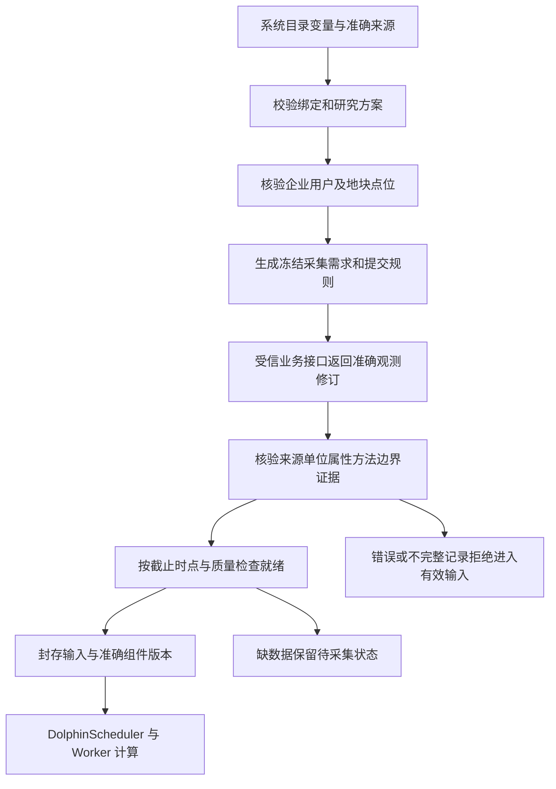

# 系统输入组件、固定来源与运行边界核对

2026-11-12 · 只读源码调查。仅新增本文件；未启动旧 API、读取环境凭据、连接数据库、调用旧远端服务或执行功能测试。本文中的“已实现”指找到对应源码，测试部分指已核对测试断言，不代表本次重跑通过。

## 1. 核对基线与结论

| 位置 | 本次核到的基线 | 用途与差异 |
|---|---|---|
| `E:/CodexData/home/worktrees/enterprise-model-services/mlgrowth` | 分支 `codex/enterprise-model-services`，HEAD `53d86cb1a3359e279776ee8825e4366d066ea859`，存在大量未提交的研究设计器改动及新增目录文件 | 本次主要迁移依据；引用均指本次读取的工作区，不能仅凭 HEAD 恢复全部内容。 |
| `E:/python/mlgrowth` | 分支 `main`，HEAD `7b599298ea64d311e77c883b37b17b1a9aae44f0`，最近提交日期 2026-10-30 | 对照基线；本次核对的组件目录、来源词典、研究变量库、来源策略、研究业务取数和运行服务等关键文件均不存在。不能以这份 main 代替当前设计器来源。 |

两处根 AGENTS、适用开发规范及 Worker 局部规则已读取。调查按“入口—合同—持久化—取数—封存—Worker—测试”展开。

**关键结论：**

1. 当前源码中的“四类”是研究变量的**来源类别**：人工采集、第三方平台接入、平台模型分析记录、物联网平台。它不是计算组件的四种技术类型。
2. 系统目录中的一个变量有一个平台指定来源。变量身份、来源绑定身份、组件版本、策略版本和具体观测修订各有不同含义，不能合并成一个“组件编号”。
3. 选择系统目录条目后，单位、科学支撑、值性质、来源版本及平台方法受合同校验；用户可以填写研究角色、采集条件，以及来源合同允许的取数属性。
4. 长势分析已有代码和候选变量，但尚未形成可用绑定；物联网只有类别及候选定义，尚无已登记的具体来源路由。
5. 点位株高和单株叶面积已在目录定义；当前通用数值观测表路径仅接收 `field_season`，仍缺点位、单株等适配。目录可选不等于数值训练可用。
6. 方案合同保留私有和历史未绑定变量。固定来源规则对已绑定系统条目有效，当前源码没有证明无绑定但同名的变量也被统一禁止。新项目应先明确系统标准与私有变量的边界。

## 2. 四类来源与其他分类体系

来源类别由 [source_dictionary.py][S01] 定义，显示名和采集方式由 [source-view.js][S02] 投影。

| 来源类别 | 代码 | 已登记具体来源 | 当前状态 |
|---|---|---|---|
| 人工采集 | `manual` | `manual` | 业务系统表单采集，方案声明真实测量方法，回传实际业务记录。 |
| 第三方平台接入 | `third_party` | `openmeteo_weather`、`soilgrids_reference_normalization`；词典另保留 NASA 等历史或候选代码 | 当前指定策略采用 Open-Meteo 天气和规范化 SoilGrids。来源存在、获得采用、项目已有数据是不同状态。 |
| 平台模型分析记录 | `platform_analysis` | `growth_trend_analysis` | 21 项候选定义展示来源；`binding=null`、`selectable=false`，等待业务授权及取数联验。 |
| 物联网平台 | `iot_platform` | 当前词典没有具体物联网来源代码 | 分类已预留；不能据此生成真实设备同步任务。 |

另外存在三套分类：

- 计算组件合同 `category` 有七类：`source/transform/mechanistic/learning/rule/training/assessment`。[组件合同][S03]
- 组件库有八个用户展示组：数据与采集、数据准备、模型计算、关系分析与条件筛查、研究成果、高级遥感处理、高级诊断与评价、空间识别；内部组件另行排除。[组件库][S04]
- 当前研究库的顶层入口只有“观察指标与因素”“算法与模型”；数据准备位于 `preprocessing`，并非再一种来源。[研究库入口][S05]

`CollectionRequirement.source` 的机器合同仍只有 `manual/third_party/business_system` 三种；四类是用户来源分类，不能直接把 `platform_analysis` 写进该字段。[采集需求合同][S06]

## 3. 权威目录、原始文件与读取入口

### 原始文件

以下均以迁移 worktree 为根，路径对应的实际文件见链接。

| 内容 | 原始路径 | 作用 |
|---|---|---|
| 当前、历史组件 | [components/current.json][J01]、[components/history.json][J02] | 当前定义供受控登记；历史准确版本供 Worker 解释旧合同。 |
| 通用变量本体 | [variables-v1.json][J03]、[variables-v2.json][J04] | 名称、代码、定义版本、单位、类型、范围及说明。 |
| 长势候选 | [variables-growth-trend-v1.json][J05] | 报告覆盖区、采样点候选及保留的业务报告统计定义。 |
| 温室变量与支撑 | [greenhouse-v1.json][J06] | 变量本体、`unit_kind`、支撑说明及人工/仪器/派生等来源属性。 |
| 来源绑定 | [sources-v1.json][J07]、[sources-v2.json][J08] | 准确变量与组件外键、字段、性质、科学支撑、允许属性及源码证据。 |
| 平台指定来源 | [source-policies-v1.json][J09] | 每指标采用的准确来源版本及固定接入协议。 |
| 人工采样旧标准 | [platform.py][S07]、[indicators.py][S08] | 五项人工采样指标的共享标准；温室人工变量另在温室目录。 |

本次仅以 JSON 解析和静态聚合核到：当前组件 55 份；研究变量定义 133 个不重复身份；来源绑定文件合计 37 份；平台策略 18 份；温室人工变量 10 项。这些是文件数量，不是在线项目已有数据数量。

### 函数入口与纯函数边界

| 入口 | 是否需要数据库 | 适用范围 |
|---|---|---|
| `model_center.component_catalog.load_current_components()` | 否，读取包资源 | 校验当前组件唯一代码。 |
| `load_builtin_components()` | 否，读取包资源 | 当前加历史，按准确代码/修订解析；不能把所有历史版本重新当当前可选组件。 |
| `research.source_catalog.builtin_research_variables()` | 否，读取包资源 | 读取变量与来源合同，校验身份唯一及来源所引变量存在。 |
| `builtin_source_policies()`、`greenhouse_variable_profiles()` | 否，读取包资源 | 读取受控策略、温室科学支撑。 |
| `designer_metadata(definition)`、`research_component_contract(definition)` | 否，纯投影 | 从组件合同推导设计器元数据和研究适配能力。 |
| `source_selection_schema(options)` | 否，纯转换 | 从允许属性生成枚举、必填和未知字段拒绝的 Schema。 |
| `research_library(session)` | **是**，另读取运行设置 | 构建真实公开研究目录；不是可独立调用的纯函数。 |

函数依据：[组件加载][S09]、[变量及来源加载][S10]、[组件投影][S11]、[属性 Schema][S12]。

**重要边界：**当前公开目录不是直接返回种子文件。`research_variable_catalog` 从数据库重建并校验合同摘要；`current_source_policies` 按语义版本取最高策略，再解析准确来源和准确组件。文件只供受控初始化，业务查询不以文件兜底。[目录查询][S13]、[平台策略][S14]

新项目若采用离线文件目录，应明确它是另一种目录存储实现，复用同一份合同及投影规则；不能假定旧库已有一个完全脱离数据库、直接生成全部公开响应的函数。

## 4. 输入的准确身份与固定字段

以土壤 pH 为例，各身份为：

| 层次 | 示例 | 固定含义 |
|---|---|---|
| 变量本体 | `soil_phh2o@1.0.0` | 测什么、单位与范围。 |
| 具体来源绑定 | `soilgrids_reference_soil_phh2o@2.0.0` | 哪个提供方字段、性质、支撑和可选土层。 |
| 来源组件 | `soilgrids_reference_normalization`，revision `1` | 哪个准确转换实现及端口合同。 |
| 平台来源策略 | `soil_phh2o@1.0.0` | 当前指定哪个准确来源和接入方法。 |
| 方案内需求 | 如 `soil_phh2o_collection` | 本研究对该变量的采集规则，不是平台标准身份。 |
| 具体记录 | `source_system + source_record_id + source_revision` | 从哪条事实及修订取得数值。 |

来源 `source.code` 是固定路由代码，如 `soilgrids_reference_normalization`；它与上述具体绑定代码不同。来源名称可以独立演进，代码不能随意改名或复用。组件到来源使用显式映射，未知组件会报错，上传新组件不会自动获得业务来源路由。[来源词典][S01]

`DataType` 同时声明 `semantic/version/shape/unit/alignment`，完整相等才兼容。相同物理量纲、相同 JSON 结构均不能替代语义和空间支撑。[端口类型][S03]

### 用户可选与不可覆盖的内容

| 内容 | 当前目录选入后的规则 | 源码依据 |
|---|---|---|
| 变量角色 | 可选驱动、协变量、目标、验证、参数、处理、分组；非实测来源不能作为目标或验证 | [变量表单][S15]、[绑定校验][S16] |
| 物理单位、数值类型、定义版本、值性质 | 必须匹配所引标准，不能把估计改为实测 | [绑定校验][S16] |
| 来源代码、准确版本、摘要、提供方 | 必须匹配指定策略与来源，不能换 NASA 或手填任意 URL | [平台策略][S14]、[取数客户端][S17] |
| 科学对象类型 `unit_kind` | 已确定的目录支撑固定，例如 point、plant、field_season | [目录投影][S05]、[变量表单][S15] |
| `fixed_unit` | 当前代码指“科学对象类型固定”，并非单指 cm 等物理单位；两种单位分别核验 | [目录投影][S05] |
| 有效值范围 | 研究可收紧，不能放宽或移除标准边界 | [范围校验][S16] |
| 土层、统计量等属性 | 只能在准确来源允许的枚举中选，每个已定义属性必选，未知属性拒绝 | [属性 Schema][S12] |
| 平台协议与处理方法 | 原样使用固定方法，表单只读，服务端比较全部方法内容 | [变量表单][S15]、[绑定校验][S16] |
| 人工测量协议 | 用户填写实际协议代码、版本、方法和说明；不是执行脚本 | [采集方法][S06] |
| 采集窗口、间隔、最低记录、独立单位数 | 研究者设置，受方案约束；最低数量不等于统计功效证明 | [采集需求][S06] |
| 真实对象、地块边界、点位与授权 | 启动时从受信业务系统核验，不从变量名称或客户端自报内容取得 | [启动及授权][S18] |

## 5. 十五项人工变量与当前运行适用范围

下列定义版本均为 `1.0.0`，值性质为 `observed`。前五项来自采样标准，后十项来自温室目录；目录层为它们选择 `manual`。实际测量方法及证据仍由研究声明。[人工标准][S07]、[指标本体][S08]、[温室目录][J06]

| code | 中文含义 | `unit_kind` | 物理单位 | 当前 `field_season` 数值表 |
|---|---|---|---|---|
| `lai` | 叶面积指数 | `field_season` | `m2_m2` | 支撑类型可直接接收 |
| `agb_kg_ha` | 地上生物量 | `field_season` | `kg_ha` | 支撑类型可直接接收 |
| `tuber_dm_kg_ha` | 块茎干物质 | `field_season` | `kg_ha` | 支撑类型可直接接收 |
| `canopy_cover` | 冠层覆盖度 | `field_season` | `fraction` | 支撑类型可直接接收 |
| `height_cm` | 株高 | `point` | `cm` | 需点位适配 |
| `plant_height` | 单株株高 | `plant` | `cm` | 需单株适配 |
| `stem_diameter` | 单株茎粗 | `plant` | `mm` | 需单株适配 |
| `internode_length` | 单株节间长 | `plant` | `cm` | 需单株适配 |
| `leaf_length` | 叶片长度 | `plant` | `cm` | 需单株适配 |
| `leaf_width` | 叶片宽度 | `plant` | `cm` | 需单株适配 |
| `plant_leaf_area` | 单株总叶面积 | `plant` | `cm2_plant` | 需单株适配 |
| `leaf_fresh_mass` | 叶鲜重 | `plant` | `g_plant` | 需单株适配 |
| `stem_fresh_mass` | 茎鲜重 | `plant` | `g_plant` | 需单株适配 |
| `stem_leaf_fresh_mass` | 茎叶总鲜重实测 | `plant` | `g_plant` | 需单株适配 |
| `marketable_fruit_yield` | 商品果产量 | `quadrat` | `kg_m2` | 需样方适配 |

“支撑类型可直接接收”仅表示能通过当前观测表空间类型要求，仍须有有效协议、真实授权对象、合格记录、足够样本及具体模型支持。它不证明任何模型已完成科学验收。[运行准备][S19]

### 旧演示变量如何对应

- `height_cm/cm` 可引用真实株高标准，但要保留 `point`，使用授权点位记录并实现相应输入适配。不能仅把 `unit_kind` 改成 `field_season`。
- `leaf_area/cm2` 在已核目录中没有相同身份。最接近的人工变量是 `plant_leaf_area/cm2_plant`，含义为单株总叶面积；`lai/m2_m2` 是单位地表面积上的叶面积指数，不能改名代替。
- 如果研究确需地块平均株高或其他叶面积统计，必须说明从哪些点/株、按什么范围与规则汇总，登记准确派生含义和来源证据；不能改单位字符串完成转换。
- 演示可暂保留明确标记的私有合成变量，仍应写清单位、支撑及模拟用途，并与系统标准接入分开验收。是否采用这条兼容路径需主代理结合新项目现有合同决定。

## 6. 十八项指定第三方来源

### 共同绑定规则

18 项变量本体版本均为 `1.0.0`，来源策略版本均为 `1.0.0`；值性质都是 `estimated`，科学对象类型为 `field_season`。它们不能作为独立实测目标或验证标签。[来源文件][J07]、[规范化来源][J08]、[指定策略][J09]

天气采用 `openmeteo_weather` revision `4`；准确来源代码为 `openmeteo_weather_<变量code>`、版本 `1.0.0`，固定方法 `openmeteo_daily_standard_record`，日界为 `Asia/Shanghai`，没有可选取数属性，`selectors={}`。

| 变量 code | 单位 | 来源字段 |
|---|---|---|
| `temperature_minimum_daily` | `celsius` | `TMIN` |
| `temperature_maximum_daily` | `celsius` | `TMAX` |
| `temperature_mean_daily` | `celsius` | `TEMP` |
| `precipitation_daily` | `mm` | `RAIN` |
| `solar_radiation_daily` | `kj_m2` | `IRRAD` |
| `wind_speed_2m_daily` | `m_s` | `WIND` |
| `vapour_pressure_daily` | `kpa` | `VAP` |

土壤采用 `soilgrids_reference_normalization` revision `1`；准确来源代码为 `soilgrids_reference_<变量code>`、版本 `2.0.0`，固定方法 `soilgrids_mapped_reference_v1`，表示静态原生网格参考。

| 变量 code | 单位 | 来源字段 |
|---|---|---|
| `soil_bdod` | `kg_dm3` | `bdod` |
| `soil_cec` | `cmol_kg` | `cec` |
| `soil_cfvo` | `percent` | `cfvo` |
| `soil_clay` | `percent` | `clay` |
| `soil_phh2o` | `dimensionless` | `phh2o` |
| `soil_sand` | `percent` | `sand` |
| `soil_silt` | `percent` | `silt` |
| `soil_soc` | `g_kg` | `soc` |
| `soil_wv0010` | `fraction` | `wv0010` |
| `soil_wv0033` | `fraction` | `wv0033` |
| `soil_wv1500` | `fraction` | `wv1500` |

土壤每项都必须选 `depth` 和 `statistic`。深度为 `0-5cm/5-15cm/15-30cm/30-60cm/60-100cm/100-200cm`；统计量当前只能是 `mean`。不能自由填写新土层、分位数或属性。研究方案 1.4 的有效观测须回传完全相同的 `source_selectors`；缺失、土层变化或未知属性均不能当作该冻结来源的有效结果。[属性合同][S12]、[观测核验][S20]

18 项在支撑类型上可进入当前 V2 研究表，但取数仍由业务系统提供准确标准记录。静态土壤在哪些业务日使用须按准确方法展开并保留静态来源，不能描述为每天重新实测。

NASA POWER、NASA 小时气温日界适配和原始 SoilGrids 都有来源定义或词典代码，但不能绕开当前策略替换已采用来源。原 NASA 日界 `LST/UTC` 不能直接当北京时间；小时适配已有独立计算实现，当前未被平台采用。[采用限制测试][T02]、[规范化测试][T05]

## 7. 运行时实际怎样解析、取数与溯源

1. **方案校验。** `validate_plan` 调用准确目录绑定核验，再编译组件和研究适配。标准来源的选择与方法被服务端核验，来源预处理组件必须已由平台采用。[方案校验][S21]
2. **授权对象。** `verified_designer` 通过受信委托取得企业/用户，事务设置资源范围及用户身份。`ResearchBusinessClient.verify_context` 核验企业、用户、完整对象集合和有效时间；请求自报 `verified` 或公司编号不产生授权。历史资源和跨研究制品复用还需复查来源项目授权。[设计身份][S22]、[资源授权][S18]、[业务客户端][S17]
3. **采集规则。** `compile_collection_templates` 返回准确方法、变量、实际对象、日期窗口和 Schema；`unit_ref` 仅能选冻结对象，方法、单位和来源可为固定值。人工与平台模板分开引用，业务端只对 `source=manual` 生成人工表单；目录模块本身不新建业务物理表。[模板编译][S23]、[研究创建][S24]
4. **实际取数。** `pull_observations` 向运维配置的固定业务端点发送主体、企业、方案摘要、上下文摘要、全部准确需求、截止时点及边界证据。响应的范围与摘要必须匹配；分页重复或超过预算会完整失败。这里是统一业务取数合同，研究 Worker 不在运行时根据用户输入 URL 自行挑提供方。[业务取数][S17]
5. **观测核验及登记。** 每条记录保留实际来源系统、记录 ID、修订、需求代码、对象、发生/可用时间、数值、单位、协议、性质、质量、证据和属性。核验来源、单位、方法、对象、种植季、真实标签及取数属性；业务端不能填写平台登记时间。相同修订不同内容拒绝，重投相同内容去重。[观测合同][S20]、[修订登记][S24]
6. **就绪与封存。** 截止时点前可用且登记的最高修订参与筛选；撤销、缺值及不合格质量不进入有效输入。核验每单位有效日期、独立单位及变量配对，缺天气不会转成人工天气采集任务。[就绪检查][S25]
7. **计算输入与成果。** 当前 `prepare_inputs` 按地块/作物/种植季/业务日生成表；同日同变量多个记录要求显式聚合或选择，不能静默平均。运行同时封存方案、上下文、就绪证据、输入、组件准确版本和摘要、制品来源；Worker 仅消费已绑定输入，执行入口不自行取得业务数据。[输入准备][S19]、[运行封存][S26]、[Worker 执行][S27]

## 8. 已有能力、规划与待确认缺口

| 项目 | 本次证据状态 | 影响与下一步建议 |
|---|---|---|
| 已绑定系统变量的来源固定 | 有服务端校验和正反测试 | 新项目应复用完整校验，不仅锁住前端选择框。 |
| 未绑定的历史/私有变量 | 合同明确允许，目录校验跳过无绑定需求 | 建议区分系统目录引用与私有变量；防止去掉绑定后继续冒用系统代码及含义。当前未找到一条统一禁止规则。 |
| 点位株高、单株/样方变量进入数值表 | 目录有定义；编译和运行均拒绝非 `field_season`，要求显式适配 | 保留真实支撑，补充适配或采用合适的已定义研究单位。不能靠重写 `unit_kind` 通过。 |
| 长势 NDVI | 来源代码、21 候选及页面展示已实现；绑定为空 | 真实报告覆盖、点位影像、日期、业务应用权限联验完成前不能当作已接入因素。原 `spectral_ndvi` 目录存在也不证明它已适用于新研究。 |
| 物联网 | 四类展示之一，温室有仪器候选 | 缺具体平台、设备/点位映射、同步及来源绑定合同。 |
| 固定来源数据就绪 | 目录始终返回 `data_available=null` | 必须在实际项目上下文检查，不因目录可选即显示数据已就绪。 |
| 真正业务链路 | 有固定客户端和隔离 HTTP 测试 | 测试声明业务身份、业务接收端和调度为替身；不能据此断言旧生产接收端已支持全部来源。 |
| 当前目录数量 | 测试期望 54 项、33 项可选：15 人工、18 第三方、21 待绑定 | 本次未查数据库和在线接口，不能当作现网实时数量。 |
| 系统组件上传 | 新组件可申报合同，但不能自动获得来源路由和采用权 | 来源注册、制品采用、模型输入能力与实际授权分开检查。 |

缺口依据：[私有变量合同][S28]、[绑定校验][S16]、[编译限制][S21]、[输入限制][S19]、[目录状态测试][T01]、[采用测试][T02]、[HTTP 测试边界][T03]。

建议新项目首先保留“标准输入只能引用已登记且已采用的准确来源”的共同规则；把上传数据、私有变量和系统标准来源分别标识。若合成演示使用私有变量，应在界面、训练制品和报告中保留其身份，不能用它证明真实农业数据接入已完成。

## 9. 已核对的测试与本次实际验证

| 测试源码 | 覆盖的可观察行为 | 本次状态 |
|---|---|---|
| [test_research_variable_library.py][T01] | 来源词典、54/33 目录期望、点位株高、长势不可选、属性 Schema、伪造来源/单位拒绝 | 只读核对断言，未运行 |
| [test_platform_source_policies.py][T02] | 18 指定来源、7 天气固定 Open-Meteo、缺天气不转人工、未采用适配拒绝、准确旧组件版本保持 | 只读核对断言，未运行 |
| [test_research_http_workflow.py][T03] | 租户响应篡改、项目撤权、历史资源与跨项目制品复用边界 | 只读核对断言，测试上游及调度为隔离替身 |
| [test_research_workflow.py][T04] | source_selectors 一致、时间截止与撤销、观测方法及对象、训练留出 | 只读核对断言，未运行 |
| [test_source_normalization.py][T05] | NASA 日界、土壤单位转换、准确原始层与统计量、V1/V2 语义 | 只读核对断言，未运行 |
| [test_research_launch.py][T06] | 逐地块点位、边界证据、撤权与启动 | 只读核对断言，未运行 |

本次实际执行：两处 Git 分支/HEAD 核对；关键文件存在性对比；源文件和调用链读取；原始 JSON 解析与身份数量核对；指定策略逐项关联到变量、来源绑定和组件。没有导入 API 或运行项目初始化。功能联验和科学效果仍需在新项目确认的隔离环境按准确合同开展。

## 证据路径

以下链接均指本次读取的迁移工作区；行号只定位入口，变动后应重新核对。

[S01]: E:/CodexData/home/worktrees/enterprise-model-services/mlgrowth/src/mlgrowth_contracts/research/source_dictionary.py:14
[S02]: E:/CodexData/home/worktrees/enterprise-model-services/mlgrowth/api/web/model_center/source-view.js:3
[S03]: E:/CodexData/home/worktrees/enterprise-model-services/mlgrowth/src/mlgrowth_contracts/model_center/components.py:24
[S04]: E:/CodexData/home/worktrees/enterprise-model-services/mlgrowth/api/services/component_library.py:14
[S05]: E:/CodexData/home/worktrees/enterprise-model-services/mlgrowth/api/services/research_variable_library.py:244
[S06]: E:/CodexData/home/worktrees/enterprise-model-services/mlgrowth/src/mlgrowth_contracts/research/plans.py:32
[S07]: E:/CodexData/home/worktrees/enterprise-model-services/mlgrowth/src/mlgrowth_contracts/timeseries/platform.py:132
[S08]: E:/CodexData/home/worktrees/enterprise-model-services/mlgrowth/src/mlgrowth_contracts/timeseries/indicators.py:22
[S09]: E:/CodexData/home/worktrees/enterprise-model-services/mlgrowth/src/mlgrowth_contracts/model_center/component_catalog.py:29
[S10]: E:/CodexData/home/worktrees/enterprise-model-services/mlgrowth/src/mlgrowth_contracts/research/source_catalog.py:60
[S11]: E:/CodexData/home/worktrees/enterprise-model-services/mlgrowth/src/mlgrowth_contracts/model_center/designer.py:51
[S12]: E:/CodexData/home/worktrees/enterprise-model-services/mlgrowth/src/mlgrowth_contracts/research/catalog_bindings.py:16
[S13]: E:/CodexData/home/worktrees/enterprise-model-services/mlgrowth/api/services/research_variable_catalog.py:26
[S14]: E:/CodexData/home/worktrees/enterprise-model-services/mlgrowth/api/services/research_source_policies.py:20
[S15]: E:/CodexData/home/worktrees/enterprise-model-services/mlgrowth/api/web/model_center/variable-view.js:92
[S16]: E:/CodexData/home/worktrees/enterprise-model-services/mlgrowth/api/services/research_variable_library.py:335
[S17]: E:/CodexData/home/worktrees/enterprise-model-services/mlgrowth/src/mlgrowth_enterprise/research_business.py:62
[S18]: E:/CodexData/home/worktrees/enterprise-model-services/mlgrowth/api/security/research_resources.py:40
[S19]: E:/CodexData/home/worktrees/enterprise-model-services/mlgrowth/src/mlgrowth_contracts/research/inputs.py:36
[S20]: E:/CodexData/home/worktrees/enterprise-model-services/mlgrowth/src/mlgrowth_contracts/research/observations.py:17
[S21]: E:/CodexData/home/worktrees/enterprise-model-services/mlgrowth/api/services/research_plan_validation.py:28
[S22]: E:/CodexData/home/worktrees/enterprise-model-services/mlgrowth/api/security/research_designs.py:35
[S23]: E:/CodexData/home/worktrees/enterprise-model-services/mlgrowth/src/mlgrowth_contracts/research/collection.py:60
[S24]: E:/CodexData/home/worktrees/enterprise-model-services/mlgrowth/api/services/research_studies/collection.py:45
[S25]: E:/CodexData/home/worktrees/enterprise-model-services/mlgrowth/src/mlgrowth_contracts/research/readiness.py:62
[S26]: E:/CodexData/home/worktrees/enterprise-model-services/mlgrowth/api/services/research_studies/runs.py:57
[S27]: E:/CodexData/home/worktrees/enterprise-model-services/mlgrowth/src/pymlgrowth/research_models/execution.py:19
[S28]: E:/CodexData/home/worktrees/enterprise-model-services/mlgrowth/src/mlgrowth_contracts/research/variables.py:25
[J01]: E:/CodexData/home/worktrees/enterprise-model-services/mlgrowth/src/mlgrowth_contracts/model_center/components/current.json
[J02]: E:/CodexData/home/worktrees/enterprise-model-services/mlgrowth/src/mlgrowth_contracts/model_center/components/history.json
[J03]: E:/CodexData/home/worktrees/enterprise-model-services/mlgrowth/src/mlgrowth_contracts/research/catalog/variables-v1.json
[J04]: E:/CodexData/home/worktrees/enterprise-model-services/mlgrowth/src/mlgrowth_contracts/research/catalog/variables-v2.json
[J05]: E:/CodexData/home/worktrees/enterprise-model-services/mlgrowth/src/mlgrowth_contracts/research/catalog/variables-growth-trend-v1.json
[J06]: E:/CodexData/home/worktrees/enterprise-model-services/mlgrowth/src/mlgrowth_contracts/research/catalog/greenhouse-v1.json
[J07]: E:/CodexData/home/worktrees/enterprise-model-services/mlgrowth/src/mlgrowth_contracts/research/catalog/sources-v1.json
[J08]: E:/CodexData/home/worktrees/enterprise-model-services/mlgrowth/src/mlgrowth_contracts/research/catalog/sources-v2.json
[J09]: E:/CodexData/home/worktrees/enterprise-model-services/mlgrowth/src/mlgrowth_contracts/research/catalog/source-policies-v1.json
[T01]: E:/CodexData/home/worktrees/enterprise-model-services/mlgrowth/tests/model_center/test_research_variable_library.py:73
[T02]: E:/CodexData/home/worktrees/enterprise-model-services/mlgrowth/tests/model_center/test_platform_source_policies.py:21
[T03]: E:/CodexData/home/worktrees/enterprise-model-services/mlgrowth/tests/model_center/test_research_http_workflow.py:5
[T04]: E:/CodexData/home/worktrees/enterprise-model-services/mlgrowth/tests/model_center/test_research_workflow.py:182
[T05]: E:/CodexData/home/worktrees/enterprise-model-services/mlgrowth/tests/model_center/test_source_normalization.py:75
[T06]: E:/CodexData/home/worktrees/enterprise-model-services/mlgrowth/tests/model_center/test_research_launch.py:155
