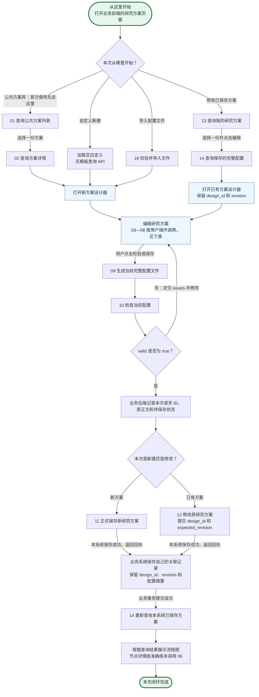

# 模型设计器 API 完整闭环流程

**从业务前端的“研究方案”页面进入。第一次使用时，先走“公共方案库”：01 查询列表 → 选择一份方案 → 02 查询详情 → 打开设计器。**

这里的页面和按钮是业务前端应实现的入口，不是新增 API；本系统 `/designer/` 是个人工作区样例。API 编号与[前端对接文档](frontend-integration.md)、[业务系统对接文档](business-api-integration.md)一致。浏览器经业务后端转接，服务 Key 和企业范围由业务后端管理。

## 先确定从哪个入口进入

| 用户要做什么 | 页面入口 | 进入设计器前调用 | 保存时调用 |
| --- | --- | --- | --- |
| 第一次采用现有方案 | 公共方案库 → 选择方案 → 使用此方案 | 01 列表 → 02 详情，读取 `definition` | 11 新建 |
| 从零设计 | 新建研究方案 → 自定义 | 使用空白定义，无需查询模板 API | 11 新建 |
| 导入配置继续设计 | 导入方案 → 选择配置文件 | 18 导入，读取 `definition` | 11 新建 |
| 修改自己已保存的方案 | 我的研究方案 → 选择方案 → 编辑 | 13 列表 → 14 详情，读取 `configuration.definition` | 12 修改 |

如果只想查看已保存方案，走 **13 → 14 → 展示流程图** 即可，不必进入编辑和保存。

## 主流程：从页面入口到保存后重查

先看绿色的“从这里开始”节点，再沿箭头向下阅读。中间的“编辑研究方案”按需使用03—08，具体触发操作见下表。

主图只显示正常设计保存过程。保存异常看下文“异常恢复”，已有训练模型浏览入口另列，不混入首次设计流程。

## 设计器打开后，03—08由什么操作触发

| 用户操作 | API | 前端接下来做什么 |
| --- | --- | --- |
| 打开“从指标库选择” | 03 查询指标库 | 显示指标、两级分类、单位、具体来源和选择属性 |
| 确认指标、用途和来源属性，点击加入 | 04 采用指标 | 将返回的变量和来源规则加入当前设计；不实际取数 |
| 打开“选择基础模型” | 05 查询基础模型列表 | 展示可采用的方法 |
| 选中一个模型，或恢复一个已保存节点 | 06 查询准确版本详情 | 显示参数表单和端口；重开时使用保存的准确版本 |
| 打开模型版本选择 | 07 查询历史版本 | 选定后用06读取该版本；不是每次都必须调用 |
| 从输出端口拖线，或点击“添加下一步” | 08 查询兼容下游输入 | 选择下游方法并用06读取详情，形成串联或分支 |

这些操作可以反复进行，并非必须把03—08按数字顺序全部执行一次。已有指标及来源绑定直接从保存配置恢复，不重新调用04覆盖历史绑定。编辑参数、删除节点或调整连线先修改当前编辑状态，再通过09、10检查。

## 异常恢复：API 15 的调用时机

| 保存时发生的情况 | 处理流程 |
| --- | --- |
| 11/12超时或响应丢失，不知道是否保存成功 | 用原 `Idempotency-Key` 调15；200则采用原回执，继续业务落库；404则用原请求ID、原正文重试11/12 |
| 10返回 `valid=false`，或正式保存返回配置错误422 | 展示 `issues`，修改设计，再走09 → 10 → 11/12 |
| 12返回修订冲突409 | 用14读取最新方案，让用户处理冲突，不能自动覆盖 |
| 相同请求ID被用于不同正文，返回409 | 核对原请求及回执，不自动换请求ID重复创建方案 |
| 本系统已成功，业务数据库保存失败 | 保留成功回执，只重试业务系统自己的关联事务；回执丢失时再用15恢复 |

15的参数是保存请求ID，不是 `design_id`；正常保存成功后无需额外调用15。11和12实际共用 `POST /api/v1/research/design-saves`，新建和修改的请求字段不同，两库也不是同一个事务。

## 独立入口：浏览已训练模型

业务前端的“已训练模型”入口走 **16 查询模型列表 → 17 查询模型详情**。它不属于“首次设计研究方案”的入口，保存研究方案也不会自动产生训练模型。

本次验收只到**保存成功 → 14重查 → 展示流程图**。实际取数、训练、预测和每日调度是后续运行流程。
