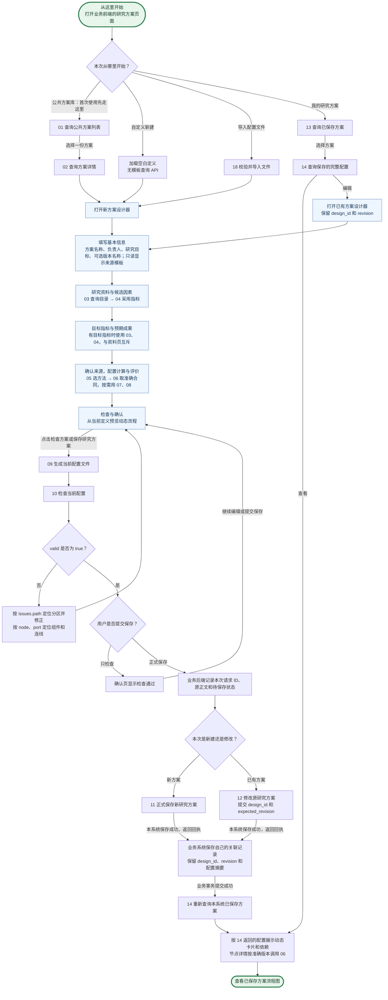
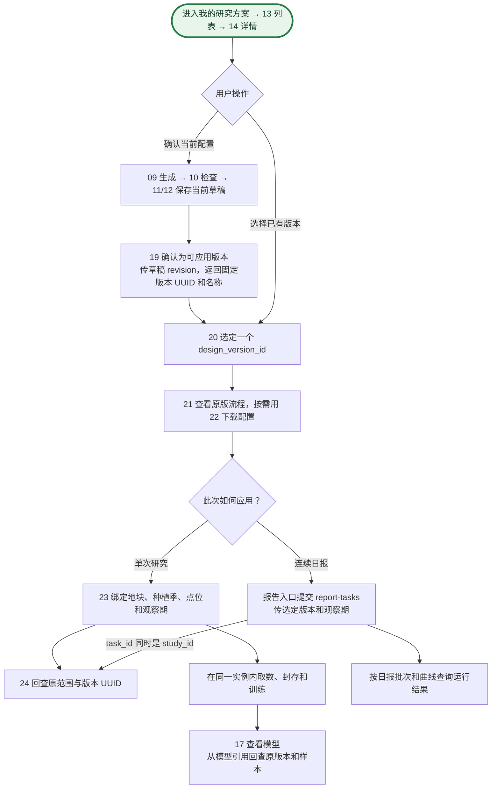

# 模型设计器 API 完整闭环流程

v0.3.0：编辑已发布方案前必须经过 26 开启新草稿，14 回读新 `draft_id` 和当前修订后才能调用 12。14 的 `draft_state=published` 时只读；旧地块研究和模型保留原正式版本。详见[发布后再次编辑](research-version-integration.md#v030发布后再次编辑)。

**从业务前端的“研究方案”页面进入。第一次使用时，先走“公共方案库”：01 查询列表 → 选择一份方案 → 02 查询详情 → 打开设计器。**

这里的页面和按钮由业务前端实现。本系统 `/designer/` 提供个人工作区样例。API 编号与前端及业务系统对接文档一致。浏览器经业务后端转接。查询平台默认方案的 01 和 02 使用服务 Key。保存企业方案，以及读取企业已保存的方案和模型时，由业务后端再传企业范围。 [前端对接文档](frontend-integration.md) · [业务系统对接文档](business-api-integration.md)

**11 月 19 日上线**后，设计保存仍由 14 回读并展示动态流程。需要应用时，从已保存方案另行确认固定版本并绑定研究实例。 [19–24 对接说明](research-version-integration.md)

## 先确定从哪个入口进入

| 用户要做什么 | 页面入口 | 打开时调用 | 保存时调用 |
| --- | --- | --- | --- |
| 第一次采用现有方案 | 公共方案库 → 选择方案 → 使用此方案 | 01 列表 → 02 详情，读取 `definition` | 11 新建 |
| 从零设计 | 新建研究方案 → 自定义 | 使用空白定义，无需查询模板 API | 11 新建 |
| 导入配置继续设计 | 导入方案 → 选择配置文件 | 18 导入，读取 `definition` | 11 新建 |
| 修改自己已保存的方案 | 我的研究方案 → 选择方案 → 编辑 | 13 列表 → 14 详情，读取 `configuration.definition` | 12 修改 |
| 只看保存后的流程 | 我的研究方案 → 选择方案 → 查看 | 13 列表 → 14 详情，读取 `configuration.definition` | 无 |

## 从页面入口到保存后重查

从绿色的「从这里开始」节点沿箭头阅读。03—08 的具体触发操作见下表。

设计环节的终点是保存后的方案流程。采样安排、对象与实际调度在应用时处理。保存异常见下文「异常恢复」。

## 从已保存方案入口确认版本并发起研究

编辑方案时只修改草稿。已有研究和模型始终用自身引用的版本 UUID，通过 21 回读原流程。

## 设计器打开后，03—08由什么操作触发

| 用户操作 | API | 前端接下来做什么 |
| --- | --- | --- |
| 在资料页或目标页打开指标库 | 03 查询指标库 | 显示指标详情、分类、单位、来源和提供方式。按 `variable.code` 展示已选择的用途并避免重复添加。 |
| 确认指标、用途和来源属性，点击加入 | 04 采用指标 | 把返回的 `variable` 和 `requirement` 加入同一份设计。已登记的计划来源可采用。 |
| 打开“选择基础模型” | 05 查询基础模型列表 | 展示可采用的方法 |
| 选中一个模型，或恢复一个已保存节点 | 06 查询准确版本详情 | 显示参数和端口，按合同配置必需的自动日期驱动。重开时用保存的准确版本。 |
| 打开模型版本选择 | 07 查询历史版本 | 选定后用06读取该版本；不是每次都必须调用 |
| 从输出端口拖线，或点击“添加下一步” | 08 查询兼容下游输入 | 选择下游方法并用06读取详情，形成串联或分支 |

按操作调用所需接口。已有指标及来源绑定直接从保存配置恢复。编辑参数、删除节点或调整连线先修改当前编辑状态，再通过 09、10 检查整份定义。分区「下一步」使用页面检查，10 校验完整配置。

## 检查预览与保存后展示的数据来源

| 页面 | 使用的数据 |
| --- | --- |
| 检查与确认 | 当前编辑定义和 06 准确合同用于构图。10 的 `valid/issues` 用于检查结果与问题定位。 |
| 已保存方案 | 14 的 `configuration.definition` 加 06 准确合同，按实际节点及依赖生成动态卡片。样本数、运行进度、误差及发布状态使用实际业务或运行记录。 |

## 异常恢复与 API 15 的调用时机

| 保存时发生的情况 | 处理流程 |
| --- | --- |
| 11/12超时或响应丢失，不知道是否保存成功 | 用原 `Idempotency-Key` 调15；200则采用原回执，继续业务落库；404则用原请求ID、原正文重试11/12 |
| 10返回 `valid=false`，或正式保存返回配置错误422 | 展示 `issues`，修改设计，再走09 → 10 → 11/12 |
| 12返回修订冲突409 | 用14读取最新方案，让用户处理冲突，不能自动覆盖 |
| 相同请求ID被用于不同正文，返回409 | 核对原请求及回执，不自动换请求ID重复创建方案 |
| 本系统已成功，业务数据库保存失败 | 保留成功回执，只重试业务系统自己的关联事务；回执丢失时再用15恢复 |

15的参数是保存请求ID，不是 `design_id`；正常保存成功后无需额外调用15。11和12实际共用 `POST /api/v1/research/design-saves`，新建和修改的请求字段不同，两库也不是同一个事务。

## 独立入口：浏览已训练模型

业务前端的“已训练模型”入口走 **16 查询模型列表 → 17 查询模型详情**。它不属于“首次设计研究方案”的入口，保存研究方案也不会自动产生训练模型。
